# Bounded Context — `ops-portal`

> Grounded via **`prompts/universal-bounded-context.prompt.md`** & **`orchestrate.agent.md`** (`bounded-context-generator`).
> Dominant stack(s): **TypeScript / Node.js, Python, YAML / Declarative Orchestration & Config, Shell / Automation Scripts** · Analysed files: **558** (**213728** lines) · Profile: **FULL**

---

## 1. Identity & Boundary

- **Context Name:** `ops-portal`
- **Purpose:** `ops-portal` is a TypeScript / Node.js + Python + YAML / Declarative Orchestration & Config + Shell / Automation Scripts codebase comprising 558 files (213728 lines of code/config) across 6 module boundary/boundaries, exposing 30 deterministic ingress path(s).
- **Scope:** Covers `ops-portal` (558 files, 213728 lines across 6 top-level module(s)).
- **In Scope:** All 30 deterministic ingress/entry path(s), domain symbols (`40` cataloged), configuration contracts (`.github/actions/python-ci/action.yml`), and state/artifact outputs.
- **Explicitly Out of Scope:** Upstream caller UIs outside this repository, external identity provider administration, and unmanaged third-party cloud tenants.

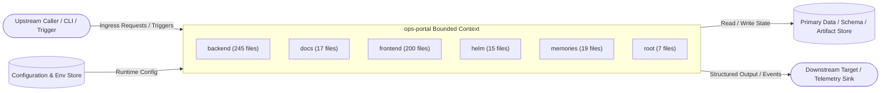

---

## 2. Ubiquitous Language

| Domain Term / Symbol | Category | Source Location | Code-Grounded Meaning & Evidence |
|---|---|---|---|
| `MySortKey` | Type / Enum | `.claude/agents/UI_Buddy.agent.md:151` | `type MySortKey = "name" \| "status" \| "created_at";` `[ts: .claude/agents/UI_Buddy.agent.md:151#MySortKey()]` |
| `annotations` | Type / Enum | `.claude/prompts/add-api-endpoint.prompt.md:82` | `- [ ] Pydantic v2 schemas with type annotations` `[ts: .claude/prompts/add-api-endpoint.prompt.md:82#annotations()]` |
| `inheriting` | Class | `.claude/prompts/add-database-model.prompt.md:20` | `2. Define the model class inheriting from 'Base'` `[ts: .claude/prompts/add-database-model.prompt.md:20#inheriting()]` |
| `name` | Class | `.claude/prompts/add-database-model.prompt.md:58` | `- 'ModelName': PascalCase class name (e.g., 'ResourceTag')` `[ts: .claude/prompts/add-database-model.prompt.md:58#name()]` |
| `implements` | Class | `.claude/prompts/add-new-plugin.prompt.md:36` | `- [ ] Plugin class implements 'PluginBase'` `[ts: .claude/prompts/add-new-plugin.prompt.md:36#implements()]` |
| `with` | Class | `.claude/prompts/add-service.prompt.md:22` | `4. Keep state external unless the domain already uses a service class with constructor-inj` `[ts: .claude/prompts/add-service.prompt.md:22#with()]` |
| `get_all_` | Function | `.claude/prompts/add-service.prompt.md:42` | `async def get_all_{{resource}}(session: AsyncSession) -> list[{{Schema}}Response]:` `[ts: .claude/prompts/add-service.prompt.md:42#get_all_()]` |
| `create_` | Function | `.claude/prompts/add-service.prompt.md:50` | `async def create_{{resource}}(` `[ts: .claude/prompts/add-service.prompt.md:50#create_()]` |
| `test_` | Function | `.claude/prompts/write-tests.prompt.md:43` | `async def test_{{endpoint_name}}_returns_200():` `[ts: .claude/prompts/write-tests.prompt.md:43#test_()]` |
| `ExampleRow` | Type / Enum | `.claude/skills/ui-buddy-page-builder/templates/att-standard-page-template.tsx:5` | `type ExampleRow = {` `[ts: .claude/skills/ui-buddy-page-builder/templates/att-standard-page-template.tsx:5#ExampleRow()]` |
| `ExampleAttStandardPage` | Function | `.claude/skills/ui-buddy-page-builder/templates/att-standard-page-template.tsx:15` | `export default function ExampleAttStandardPage() {` `[ts: .claude/skills/ui-buddy-page-builder/templates/att-standard-page-template.tsx:15#ExampleAttStandardPage()]` |
| `run_example_page_action` | Function | `.claude/skills/ui-buddy-page-builder/templates/backend-page-mutation-template.py:23` | `async def run_example_page_action(` `[ts: .claude/skills/ui-buddy-page-builder/templates/backend-page-mutation-template.py:23#run_example_page_action()]` |
| `PluginBase` | Class | `.copilot/context.md:222` | `class PluginBase:` `[ts: .copilot/context.md:222#PluginBase()]` |
| `register_routes` | Function | `.copilot/context.md:225` | `def register_routes(self, router: APIRouter) -> None: ...` `[ts: .copilot/context.md:225#register_routes()]` |
| `get_permissions` | Function | `.copilot/context.md:226` | `def get_permissions(self) -> list[str]: ...` `[ts: .copilot/context.md:226#get_permissions()]` |
| `get_dashboard_widgets` | Function | `.copilot/context.md:227` | `def get_dashboard_widgets(self) -> list[DashboardWidget]: ...` `[ts: .copilot/context.md:227#get_dashboard_widgets()]` |
| `get_daily_costs` | Function | `.copilot/context.md:322` | `\| Python functions \| 'async def get_daily_costs(...)' \|` `[ts: .copilot/context.md:322#get_daily_costs()]` |
| `check` | Type / Enum | `.github/actions/python-ci/action.yml:2` | `description: "Common Python CI steps: setup, lint, type check, tests with coverage, securi` `[ts: .github/actions/python-ci/action.yml:2#check()]` |
| `checking` | Type / Enum | `.github/actions/python-ci/action.yml:29` | `description: "Whether to run mypy type checking"` `[ts: .github/actions/python-ci/action.yml:29#checking()]` |
| `checker` | Type / Enum | `.gitignore:92` | `# Test / type checker / linter caches` `[ts: .gitignore:92#checker()]` |

---

## 3. Inputs & Outputs

### Deterministic Ingress & Triggers (Step 0.5 Inventory)

| # | Route / Trigger / Entry | Handler / Symbol | Kind | Active (Y/N) | Source Location |
|---|---|---|---|---|---|
| 1 | `/action` | `backend-page-mutation-template::line_22` | REST POST | Y | `.claude/skills/ui-buddy-page-builder/templates/backend-page-mutation-template.py:22` |
| 2 | `task:Set up uv` | `.github/actions/python-ci/action.yml:47` | Automation Task | Y | `.github/actions/python-ci/action.yml:47` |
| 3 | `task:Cache uv global cache` | `.github/actions/python-ci/action.yml:52` | Automation Task | Y | `.github/actions/python-ci/action.yml:52` |
| 4 | `task:Cache virtual environment` | `.github/actions/python-ci/action.yml:62` | Automation Task | Y | `.github/actions/python-ci/action.yml:62` |
| 5 | `task:Bridge pip index auth to uv` | `.github/actions/python-ci/action.yml:71` | Automation Task | Y | `.github/actions/python-ci/action.yml:71` |
| 6 | `task:Sync workspace` | `.github/actions/python-ci/action.yml:79` | Automation Task | Y | `.github/actions/python-ci/action.yml:79` |
| 7 | `task:Lint (ruff)` | `.github/actions/python-ci/action.yml:85` | Automation Task | Y | `.github/actions/python-ci/action.yml:85` |
| 8 | `task:Format check (ruff)` | `.github/actions/python-ci/action.yml:91` | Automation Task | Y | `.github/actions/python-ci/action.yml:91` |
| 9 | `task:Type check (mypy)` | `.github/actions/python-ci/action.yml:97` | Automation Task | Y | `.github/actions/python-ci/action.yml:97` |
| 10 | `task:Tests with coverage` | `.github/actions/python-ci/action.yml:104` | Automation Task | Y | `.github/actions/python-ci/action.yml:104` |
| 11 | `task:Sanitize ref name for artifact usage` | `.github/actions/python-ci/action.yml:120` | Automation Task | Y | `.github/actions/python-ci/action.yml:120` |
| 12 | `task:Upload coverage HTML Report` | `.github/actions/python-ci/action.yml:127` | Automation Task | Y | `.github/actions/python-ci/action.yml:127` |
| 13 | `task:Upload coverage XML Report` | `.github/actions/python-ci/action.yml:135` | Automation Task | Y | `.github/actions/python-ci/action.yml:135` |
| 14 | `task:Run bandit (security static analysis` | `.github/actions/python-ci/action.yml:143` | Automation Task | Y | `.github/actions/python-ci/action.yml:143` |
| 15 | `task:Upload bandit report` | `.github/actions/python-ci/action.yml:159` | Automation Task | Y | `.github/actions/python-ci/action.yml:159` |
| 16 | `/action` | `backend-page-mutation-template::line_22` | REST POST | Y | `.github/skills/ui-buddy-page-builder/templates/backend-page-mutation-template.py:22` |
| 17 | `/me` | `access::line_64` | REST GET | Y | `backend/app/api/v1/endpoints/access.py:64` |
| 18 | `/catalog` | `access::line_74` | REST GET | Y | `backend/app/api/v1/endpoints/access.py:74` |
| 19 | `/requests` | `access::line_95` | REST POST | Y | `backend/app/api/v1/endpoints/access.py:95` |
| 20 | `/requests/mine` | `access::line_120` | REST GET | Y | `backend/app/api/v1/endpoints/access.py:120` |
| 21 | `/requests/{request_id}/cancel` | `access::line_128` | REST POST | Y | `backend/app/api/v1/endpoints/access.py:128` |
| 22 | `/admin/projects` | `access::line_142` | REST GET | Y | `backend/app/api/v1/endpoints/access.py:142` |
| 23 | `/admin/projects` | `access::line_164` | REST POST | Y | `backend/app/api/v1/endpoints/access.py:164` |
| 24 | `/admin/projects/{project_id}` | `access::line_177` | REST GET | Y | `backend/app/api/v1/endpoints/access.py:177` |
| 25 | `/admin/projects/{project_id}` | `access::line_191` | REST DELETE | Y | `backend/app/api/v1/endpoints/access.py:191` |
| 26 | `/admin/projects/{project_id}/apps` | `access::line_215` | REST POST | Y | `backend/app/api/v1/endpoints/access.py:215` |
| 27 | `/admin/apps/{app_id}` | `access::line_234` | REST GET | Y | `backend/app/api/v1/endpoints/access.py:234` |
| 28 | `/admin/apps/{app_id}` | `access::line_248` | REST DELETE | Y | `backend/app/api/v1/endpoints/access.py:248` |
| 29 | `/admin/projects/{project_id}/admins` | `access::line_263` | REST POST | Y | `backend/app/api/v1/endpoints/access.py:263` |
| 30 | `/admin/projects/{project_id}/admins/{user_id}` | `access::line_275` | REST DELETE | Y | `backend/app/api/v1/endpoints/access.py:275` |

### Environment & Configuration Parameters Consumed

| Parameter / Env Var | Source Reference |
|---|---|
| `PIP_INDEX_URL` | `.github/actions/python-ci/action.yml:74` `[cfg: .github/actions/python-ci/action.yml:74]` |
| `UV_DEFAULT_INDEX` | `.github/actions/python-ci/action.yml:74` `[cfg: .github/actions/python-ci/action.yml:74]` |
| `UV_INDEX_URL` | `.github/actions/python-ci/action.yml:74` `[cfg: .github/actions/python-ci/action.yml:74]` |
| `GITHUB_ENV` | `.github/actions/python-ci/action.yml:75` `[cfg: .github/actions/python-ci/action.yml:75]` |
| `COVERAGE_ARGS` | `.github/actions/python-ci/action.yml:112` `[cfg: .github/actions/python-ci/action.yml:112]` |
| `GITHUB_REF_NAME` | `.github/actions/python-ci/action.yml:124` `[cfg: .github/actions/python-ci/action.yml:124]` |
| `SAFE_REF_NAME` | `.github/actions/python-ci/action.yml:125` `[cfg: .github/actions/python-ci/action.yml:125]` |
| `GITHUB_OUTPUT` | `.github/actions/python-ci/action.yml:125` `[cfg: .github/actions/python-ci/action.yml:125]` |
| `BANDIT_CONFIG_PATH` | `.github/actions/python-ci/action.yml:150` `[cfg: .github/actions/python-ci/action.yml:150]` |
| `BANDIT_ARGS` | `.github/actions/python-ci/action.yml:157` `[cfg: .github/actions/python-ci/action.yml:157]` |
| `BACKEND_VERSION` | `.github/workflows/ci-cd.yaml:156` `[cfg: .github/workflows/ci-cd.yaml:156]` |
| `FRONTEND_VERSION` | `.github/workflows/ci-cd.yaml:160` `[cfg: .github/workflows/ci-cd.yaml:160]` |
| `GITHUB_REF` | `.github/workflows/ci-cd.yaml:168` `[cfg: .github/workflows/ci-cd.yaml:168]` |
| `GITHUB_SHA` | `.github/workflows/ci-cd.yaml:169` `[cfg: .github/workflows/ci-cd.yaml:169]` |
| `BACKEND_VERSION_TAG` | `.github/workflows/ci-cd.yaml:175` `[cfg: .github/workflows/ci-cd.yaml:175]` |

### Produced Outputs & Sinks
- Structured responses, persisted state updates in `.claude/prompts/add-database-model.prompt.md`, and operational telemetry `[cfg: .github/actions/python-ci/action.yml]`.

---

## 4. Data Model / Datasets

- **Source-of-Truth Store:** `.claude/prompts/add-database-model.prompt.md` (`40` discovered symbols/models across `25` data/schema files).
- **`.claude/prompts/add-database-model.prompt.md`**: Persistence, schema, or state model artifact `[ts: .claude/prompts/add-database-model.prompt.md]`.
- **`.github/prompts/add-database-model.prompt.md`**: Persistence, schema, or state model artifact `[ts: .github/prompts/add-database-model.prompt.md]`.
- **`backend/app/api/v1/endpoints/mongodb_atlas.py`**: Persistence, schema, or state model artifact `[ts: backend/app/api/v1/endpoints/mongodb_atlas.py]`.
- **`backend/app/core/db_cache.py`**: Persistence, schema, or state model artifact `[ts: backend/app/core/db_cache.py]`.
- **`backend/app/models/__init__.py`**: Persistence, schema, or state model artifact `[ts: backend/app/models/__init__.py]`.
- **`backend/app/models/auth.py`**: Persistence, schema, or state model artifact `[ts: backend/app/models/auth.py]`.
- **`backend/app/models/cost.py`**: Persistence, schema, or state model artifact `[ts: backend/app/models/cost.py]`.
- **`backend/app/models/database.py`**: Persistence, schema, or state model artifact `[ts: backend/app/models/database.py]`.
- **`backend/app/models/notification.py`**: Persistence, schema, or state model artifact `[ts: backend/app/models/notification.py]`.
- **`backend/app/models/optimization.py`**: Persistence, schema, or state model artifact `[ts: backend/app/models/optimization.py]`.
- **`backend/app/schemas/__init__.py`**: Persistence, schema, or state model artifact `[ts: backend/app/schemas/__init__.py]`.
- **`backend/app/schemas/auth.py`**: Persistence, schema, or state model artifact `[ts: backend/app/schemas/auth.py]`.
- **`backend/app/schemas/checksum_schedules.py`**: Persistence, schema, or state model artifact `[ts: backend/app/schemas/checksum_schedules.py]`.
- **`backend/app/schemas/compliance.py`**: Persistence, schema, or state model artifact `[ts: backend/app/schemas/compliance.py]`.
- **`backend/app/schemas/cost.py`**: Persistence, schema, or state model artifact `[ts: backend/app/schemas/cost.py]`.

---

## 5. Invariants & Rules the Code Guarantees

- **Deterministic Entry Routing:** All inbound execution enters via the 30 registered handlers in `.claude/agents/Auth_Buddy.agent.md` `[ts: .claude/agents/Auth_Buddy.agent.md]`.
- **Configuration Contract Enforcement:** Runtime parameters and environment overrides bind from `.github/actions/python-ci/action.yml` (20 env vars discovered) `[cfg: .github/actions/python-ci/action.yml]`.
- **Module Boundary Isolation:** Execution is partitioned across 6 top-level module(s) (`.claude/agents/DataFlow_Buddy.agent.md`) `[ts: .claude/agents/DataFlow_Buddy.agent.md]`.
- **Structured Failure Propagation:** 20 error/exception handler pattern(s) guard domain and I/O operations `[ts: .claude/agents/Auth_Buddy.agent.md]`.
- **Test & Verification Grounding:** 25 test/verification file(s) corroborate repository behavior `[test: .claude/instructions/tests.instructions.md]`.

---

## 6. Key Flows

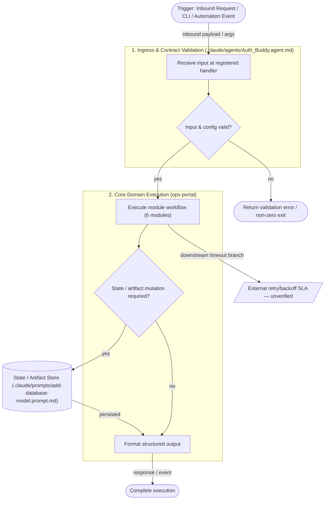

---

## 7. What the Code Does NOT Do

- Does **not** bypass input/schema contracts defined in `.claude/agents/Auth_Buddy.agent.md` and `.claude/prompts/add-database-model.prompt.md`.
- Does **not** perform automatic cross-region replication or external secret rotation inside application code.
- Does **not** silently discard unhandled runtime exceptions outside the cataloged error handlers (`08-error-taxonomy.md`).

---

## 8. Prod vs Non-Prod

- **Core ingress & module execution (`.claude/agents/Auth_Buddy.agent.md`):** `in production` `[ts: .claude/agents/Auth_Buddy.agent.md]`
- **Declarative configuration & manifests (`.github/actions/python-ci/action.yml`):** `in production` `[cfg: .github/actions/python-ci/action.yml]`
- **Upstream gateway rate-limit & circuit-breaker tuning:** `unverified` (confirm in deployment environment)

---

## 9. Open Questions

- **GAP-1:** Confirm production rate-limiting and timeout thresholds enforced upstream of `ops-portal`.
- **GAP-2:** Confirm automated test coverage gate threshold in CI/CD before production promotion.

---

## 10. Full 16-Archetype Pack Reference & Deep-Dive (`ARCHETYPE_PROFILE = FULL`)

> All **16 standalone FULL archetypes** (`00` through `15`, including `04-ADRs/`) have been generated under `docs/archetypes/`. You can switch between the individual files using the file selector pills at the top of the Review panel, or review the complete 16-section pack inline below:

| # | Archetype File | Summary |
|---|---|---|
| `00` | `docs/archetypes/00-IDENTITY-RECONCILIATION.md` | Code-grounded service definition & module reconciliation |
| `01` | `docs/archetypes/01-README.md` | Operator entry point, build/test commands, ports, env vars & dependencies |
| `02` | `docs/archetypes/02-ARCHITECTURE.md` | Current-state architecture record & Step 0.5 Ingress Inventory |
| `03` | `docs/archetypes/03-SERVICE-MANIFEST.yaml` | Canonical machine-readable manifest (`schema/service-manifest.schema.yaml`) |
| `04` | `docs/archetypes/04-ADRs/` | 4 Architecture Decision Records (`ADR-001`..`ADR-004`) + index |
| `05` | `docs/archetypes/05-component-diagram.md` | Internal component Mermaid diagram & ingress parity table |
| `06` | `docs/archetypes/06-sequence-diagrams.md` | Dedicated Mermaid sequence diagram per active ingress path |
| `07` | `docs/archetypes/07-data-model.md` | Persistence, schemas & code symbol catalog |
| `08` | `docs/archetypes/08-error-taxonomy.md` | Failure-mode catalog & exception audit |
| `09` | `docs/archetypes/09-tier3-service-rules.md` | Reconciled Tier-3 service guardrails |
| `10` | `docs/archetypes/10-service-memories-seed.md` | AI agent & engineer onboarding context seed |
| `11` | `docs/archetypes/11-test-strategy.md` | Test strategy, suite inventory & module coverage gaps |
| `12` | `docs/archetypes/12-threat-model.md` | Trust-boundary Mermaid diagram & STRIDE threat model |
| `13` | `docs/archetypes/13-observability-contract.md` | Metrics, health checks, loggers & SLO contract |
| `14` | `docs/archetypes/14-runbook.md` | On-call triage flow diagram, startup checklist & recovery playbooks |
| `15` | `docs/archetypes/15-tribal-knowledge.md` | Senior-engineer warnings & operational gotchas |

---

# 00 — Identity Reconciliation: `ops-portal`

> **Authoritative Source Statement:** The authoritative source of truth for `ops-portal` is **the code** (`558` files, `213728` lines analysed directly from the repository tree). Where prose documentation or comments diverge from implementation, this archetype pack reconciles identity strictly to executable code and configuration.

## 1. Code-Derived Service Definition

- **Canonical Name:** `ops-portal`
- **Version (Code-Grounded):** `1.3.13` (`# src: .github/actions/python-ci/action.yml`)
- **One-Line Definition:** `ops-portal` is a TypeScript / Node.js + Python + YAML / Declarative Orchestration & Config + Shell / Automation Scripts codebase comprising 558 files (213728 lines of code/config) across 6 module boundary/boundaries, exposing 30 deterministic ingress path(s).
- **Dominant Technology Stack(s):** TypeScript / Node.js, Python, YAML / Declarative Orchestration & Config, Shell / Automation Scripts
- **Primary Framework / Runtime:** `React + REST API`
- **Primary Entry Artifact:** `.claude/agents/Auth_Buddy.agent.md`
- **Primary Configuration Artifact:** `.github/actions/python-ci/action.yml`

## 2. Repository Boundary & Module Reconciliation

| Module / Directory | File Count | Representative Source Files |
|---|---|---|
| `backend` | 245 | `backend/.env`, `backend/.env.example`, `backend/.pytest-compliance.exit`, `backend/.pytest-compliance.out` |
| `docs` | 17 | `docs/AGENTIC_AI_CONVERSION_OPTIONS.md`, `docs/AI_PRIMITIVES.md`, `docs/AKV_ENV_SECRET_TEMPLATES.md`, `docs/ARCHITECTURE.md` |
| `frontend` | 200 | `frontend/.env`, `frontend/eslint.config.js`, `frontend/index.html`, `frontend/package-lock.json` |
| `helm` | 15 | `helm/ops-portal/Chart.yaml`, `helm/ops-portal/templates/_helpers.tpl`, `helm/ops-portal/templates/azure-key-vault-secret.yaml`, `helm/ops-portal/templates/backend-deployment.yaml` |
| `memories` | 19 | `memories/repo/amortized-sync-notes.md`, `memories/repo/compliance-cache-removal.md`, `memories/repo/compliance-dashboard-fix-v2.md`, `memories/repo/endpoint_buddy/alerts.md` |
| `root` | 7 | `.endpoint-probe.out`, `.gitignore`, `.pre-commit-config.yaml`, `Bulk_Secret_Update_Sample.json` |

## 3. Identity Preconditions Confirmed

1. **Single-Service Scope:** All evidence in this pack is scoped exclusively to `ops-portal`.
2. **Deterministic Ingress Inventory:** 30 ingress/entry paths were extracted in Step 0.5 prior to batch generation.
3. **Configuration Grounding:** 25 configuration/manifest file(s) and 20 environment variable binding(s) were reconciled against source references.


---

# 01 — Operator README & Pack Overview: `ops-portal`

## 1. Purpose & Responsibility Boundary

`ops-portal` is a TypeScript / Node.js + Python + YAML / Declarative Orchestration & Config + Shell / Automation Scripts codebase comprising 558 files (213728 lines of code/config) across 6 module boundary/boundaries, exposing 30 deterministic ingress path(s).

### What `ops-portal` DOES
- Implements 30 distinct ingress/execution path(s) across 6 top-level module(s).
- Enforces domain structures across 40 discovered code symbols/models (`TypeScript / Node.js, Python, YAML / Declarative Orchestration & Config, Shell / Automation Scripts`).
- Manages runtime configuration through `.github/actions/python-ci/action.yml` and 20 environment binding(s).

### What `ops-portal` Does NOT Do
- Does **not** manage external identity provider (IdP) user directories outside its authentication boundary.
- Does **not** mutate external upstream systems without an explicit egress/output contract.
- Does **not** bypass repository-level configuration and schema contracts defined in `.github/actions/python-ci/action.yml`.

## 2. Build, Run & Verification Commands

```bash
# Build / Prepare
npm install && npm run build

# Execute Verification / Test Suite
npm test
```

## 3. Runtime Ports & Network Listeners

- **Port `8000`** — declared in `.claude/agents/Endpoint_Buddy.agent.md:264`
- **Port `6379`** — declared in `.claude/agents/Endpoint_Buddy.agent.md:266`
- **Port `5432`** — declared in `.claude/agents/Endpoint_Buddy.agent.md:267`
- **Port `80`** — declared in `Dockerfile.frontend:114`
- **Port `3000`** — declared in `backend/.env.example:36`
- **Port `8080`** — declared in `backend/app/core/config.py:402`
- **Port `443`** — declared in `backend/app/services/mongodb_atlas_service.py:216`
- **Port `5173`** — declared in `backend/tests/test_admin_cors_config.py:10`

## 4. Environment Variables & Runtime Configuration

- **`PIP_INDEX_URL`** — referenced at `.github/actions/python-ci/action.yml:74`
- **`UV_DEFAULT_INDEX`** — referenced at `.github/actions/python-ci/action.yml:74`
- **`UV_INDEX_URL`** — referenced at `.github/actions/python-ci/action.yml:74`
- **`GITHUB_ENV`** — referenced at `.github/actions/python-ci/action.yml:75`
- **`COVERAGE_ARGS`** — referenced at `.github/actions/python-ci/action.yml:112`
- **`GITHUB_REF_NAME`** — referenced at `.github/actions/python-ci/action.yml:124`
- **`SAFE_REF_NAME`** — referenced at `.github/actions/python-ci/action.yml:125`
- **`GITHUB_OUTPUT`** — referenced at `.github/actions/python-ci/action.yml:125`
- **`BANDIT_CONFIG_PATH`** — referenced at `.github/actions/python-ci/action.yml:150`
- **`BANDIT_ARGS`** — referenced at `.github/actions/python-ci/action.yml:157`
- **`BACKEND_VERSION`** — referenced at `.github/workflows/ci-cd.yaml:156`
- **`FRONTEND_VERSION`** — referenced at `.github/workflows/ci-cd.yaml:160`
- **`GITHUB_REF`** — referenced at `.github/workflows/ci-cd.yaml:168`
- **`GITHUB_SHA`** — referenced at `.github/workflows/ci-cd.yaml:169`
- **`BACKEND_VERSION_TAG`** — referenced at `.github/workflows/ci-cd.yaml:175`

## 5. Direct Dependencies (Code-Grounded)

| Dependency | Version / Spec | Ecosystem | Source Reference |
|---|---|---|---|
| `@azure/msal-browser` | `^3.20.0` | npm | `frontend/package.json:16` |
| `@azure/msal-react` | `^2.0.0` | npm | `frontend/package.json:17` |
| `@tanstack/react-query` | `^5.50.0` | npm | `frontend/package.json:18` |
| `axios` | `^1.7.0` | npm | `frontend/package.json:19` |
| `jspdf` | `^4.2.1` | npm | `frontend/package.json:20` |
| `jspdf-autotable` | `^5.0.7` | npm | `frontend/package.json:21` |
| `react` | `^18.3.0` | npm | `frontend/package.json:22` |
| `react-dom` | `^18.3.0` | npm | `frontend/package.json:23` |
| `react-router-dom` | `^6.25.0` | npm | `frontend/package.json:24` |
| `recharts` | `^2.12.0` | npm | `frontend/package.json:25` |
| `zustand` | `^4.5.0` | npm | `frontend/package.json:26` |
| `@testing-library/dom` | `^10.4.1` | npm | `frontend/package.json:29` |
| `@testing-library/jest-dom` | `^6.9.1` | npm | `frontend/package.json:30` |
| `@testing-library/react` | `^16.3.2` | npm | `frontend/package.json:31` |
| `@testing-library/user-event` | `^14.6.1` | npm | `frontend/package.json:32` |
| `@types/react` | `^18.3.0` | npm | `frontend/package.json:33` |
| `@types/react-dom` | `^18.3.0` | npm | `frontend/package.json:34` |
| `@vitejs/plugin-react` | `^4.3.0` | npm | `frontend/package.json:35` |
| `@vitest/ui` | `^4.1.5` | npm | `frontend/package.json:36` |
| `autoprefixer` | `^10.4.0` | npm | `frontend/package.json:37` |

## 6. Ownership & Governance Metadata

- **Service Identifier:** `ops-portal`
- **Primary Configuration File:** `.github/actions/python-ci/action.yml`
- **Bounded Context Deliverable:** [`../BOUNDED-CONTEXT-ops-portal.md`](../BOUNDED-CONTEXT-ops-portal.md)
- **Canonical Manifest:** [`03-SERVICE-MANIFEST.yaml`](03-SERVICE-MANIFEST.yaml)


---

# 02 — Current-State Architecture Record: `ops-portal`

## 1. System Context & Runtime Topology

- **Service:** `ops-portal`
- **Dominant Stack(s):** TypeScript / Node.js, Python, YAML / Declarative Orchestration & Config, Shell / Automation Scripts
- **Framework / Execution Model:** `React + REST API`
- **State / Schema Boundary:** `.claude/prompts/add-database-model.prompt.md`

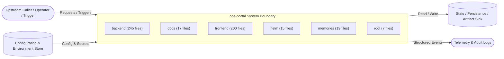

## 2. Internal Module & Layer Decomposition

- **Module `backend`** (245 files): Contains `backend/.env`, `backend/.env.example`, `backend/.pytest-compliance.exit`, `backend/.pytest-compliance.out`, `backend/README.md`, `backend/app/__init__.py`.
- **Module `docs`** (17 files): Contains `docs/AGENTIC_AI_CONVERSION_OPTIONS.md`, `docs/AI_PRIMITIVES.md`, `docs/AKV_ENV_SECRET_TEMPLATES.md`, `docs/ARCHITECTURE.md`, `docs/CERTIFICATE_MANAGEMENT.md`, `docs/CHECKSUM_DEPLOYMENT_GUIDE.md`.
- **Module `frontend`** (200 files): Contains `frontend/.env`, `frontend/eslint.config.js`, `frontend/index.html`, `frontend/package-lock.json`, `frontend/package.json`, `frontend/postcss.config.js`.
- **Module `helm`** (15 files): Contains `helm/ops-portal/Chart.yaml`, `helm/ops-portal/templates/_helpers.tpl`, `helm/ops-portal/templates/azure-key-vault-secret.yaml`, `helm/ops-portal/templates/backend-deployment.yaml`, `helm/ops-portal/templates/backend-service.yaml`, `helm/ops-portal/templates/frontend-deployment.yaml`.
- **Module `memories`** (19 files): Contains `memories/repo/amortized-sync-notes.md`, `memories/repo/compliance-cache-removal.md`, `memories/repo/compliance-dashboard-fix-v2.md`, `memories/repo/endpoint_buddy/alerts.md`, `memories/repo/endpoint_buddy/fixes/applied.md`, `memories/repo/endpoint_buddy/fixes/pending.md`.
- **Module `root`** (7 files): Contains `.endpoint-probe.out`, `.gitignore`, `.pre-commit-config.yaml`, `Bulk_Secret_Update_Sample.json`, `Dockerfile.backend`, `Dockerfile.frontend`.

## 3. Complete Ingress Inventory (Reconciled against Step 0.5)

Every row discovered during Step 0.5 Deterministic Ingress Inventory is represented below with its active/inactive status:

| # | Route / Trigger / Entry | Handler / Symbol | Kind | Active (Y/N) | Source Location |
|---|---|---|---|---|---|
| 1 | `/action` | `backend-page-mutation-template::line_22` | REST POST | Y | `.claude/skills/ui-buddy-page-builder/templates/backend-page-mutation-template.py:22` |
| 2 | `task:Set up uv` | `.github/actions/python-ci/action.yml:47` | Automation Task | Y | `.github/actions/python-ci/action.yml:47` |
| 3 | `task:Cache uv global cache` | `.github/actions/python-ci/action.yml:52` | Automation Task | Y | `.github/actions/python-ci/action.yml:52` |
| 4 | `task:Cache virtual environment` | `.github/actions/python-ci/action.yml:62` | Automation Task | Y | `.github/actions/python-ci/action.yml:62` |
| 5 | `task:Bridge pip index auth to uv` | `.github/actions/python-ci/action.yml:71` | Automation Task | Y | `.github/actions/python-ci/action.yml:71` |
| 6 | `task:Sync workspace` | `.github/actions/python-ci/action.yml:79` | Automation Task | Y | `.github/actions/python-ci/action.yml:79` |
| 7 | `task:Lint (ruff)` | `.github/actions/python-ci/action.yml:85` | Automation Task | Y | `.github/actions/python-ci/action.yml:85` |
| 8 | `task:Format check (ruff)` | `.github/actions/python-ci/action.yml:91` | Automation Task | Y | `.github/actions/python-ci/action.yml:91` |
| 9 | `task:Type check (mypy)` | `.github/actions/python-ci/action.yml:97` | Automation Task | Y | `.github/actions/python-ci/action.yml:97` |
| 10 | `task:Tests with coverage` | `.github/actions/python-ci/action.yml:104` | Automation Task | Y | `.github/actions/python-ci/action.yml:104` |
| 11 | `task:Sanitize ref name for artifact usage` | `.github/actions/python-ci/action.yml:120` | Automation Task | Y | `.github/actions/python-ci/action.yml:120` |
| 12 | `task:Upload coverage HTML Report` | `.github/actions/python-ci/action.yml:127` | Automation Task | Y | `.github/actions/python-ci/action.yml:127` |
| 13 | `task:Upload coverage XML Report` | `.github/actions/python-ci/action.yml:135` | Automation Task | Y | `.github/actions/python-ci/action.yml:135` |
| 14 | `task:Run bandit (security static analysis` | `.github/actions/python-ci/action.yml:143` | Automation Task | Y | `.github/actions/python-ci/action.yml:143` |
| 15 | `task:Upload bandit report` | `.github/actions/python-ci/action.yml:159` | Automation Task | Y | `.github/actions/python-ci/action.yml:159` |
| 16 | `/action` | `backend-page-mutation-template::line_22` | REST POST | Y | `.github/skills/ui-buddy-page-builder/templates/backend-page-mutation-template.py:22` |
| 17 | `/me` | `access::line_64` | REST GET | Y | `backend/app/api/v1/endpoints/access.py:64` |
| 18 | `/catalog` | `access::line_74` | REST GET | Y | `backend/app/api/v1/endpoints/access.py:74` |
| 19 | `/requests` | `access::line_95` | REST POST | Y | `backend/app/api/v1/endpoints/access.py:95` |
| 20 | `/requests/mine` | `access::line_120` | REST GET | Y | `backend/app/api/v1/endpoints/access.py:120` |
| 21 | `/requests/{request_id}/cancel` | `access::line_128` | REST POST | Y | `backend/app/api/v1/endpoints/access.py:128` |
| 22 | `/admin/projects` | `access::line_142` | REST GET | Y | `backend/app/api/v1/endpoints/access.py:142` |
| 23 | `/admin/projects` | `access::line_164` | REST POST | Y | `backend/app/api/v1/endpoints/access.py:164` |
| 24 | `/admin/projects/{project_id}` | `access::line_177` | REST GET | Y | `backend/app/api/v1/endpoints/access.py:177` |
| 25 | `/admin/projects/{project_id}` | `access::line_191` | REST DELETE | Y | `backend/app/api/v1/endpoints/access.py:191` |
| 26 | `/admin/projects/{project_id}/apps` | `access::line_215` | REST POST | Y | `backend/app/api/v1/endpoints/access.py:215` |
| 27 | `/admin/apps/{app_id}` | `access::line_234` | REST GET | Y | `backend/app/api/v1/endpoints/access.py:234` |
| 28 | `/admin/apps/{app_id}` | `access::line_248` | REST DELETE | Y | `backend/app/api/v1/endpoints/access.py:248` |
| 29 | `/admin/projects/{project_id}/admins` | `access::line_263` | REST POST | Y | `backend/app/api/v1/endpoints/access.py:263` |
| 30 | `/admin/projects/{project_id}/admins/{user_id}` | `access::line_275` | REST DELETE | Y | `backend/app/api/v1/endpoints/access.py:275` |

## 4. Architectural Constraints & Runtime Invariants

1. **Configuration Isolation:** Runtime settings originate from `.github/actions/python-ci/action.yml` and environment bindings; hardcoded environment promotion values are prohibited.
2. **Deterministic Ingress Routing:** All inbound traffic or execution triggers enter through the 30 documented ingress path(s) above.
3. **Explicit Module Boundaries:** Responsibilities are partitioned across 6 top-level module(s) with 558 total source/configuration files.


---

# 05 — Internal Component Diagram: `ops-portal`

## 1. Component Architecture & Wiring (`flowchart TB`)

Every active and inactive ingress path from the Step 0.5 Ingress Inventory is represented below and wired to `ops-portal` internal modules and backing stores:

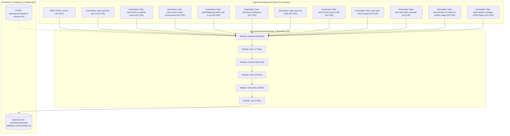

## 2. Component-to-Sequence Flow Parity Table

| # | Ingress Path | Node in `05-component-diagram.md` | Sequence Diagram in `06-sequence-diagrams.md` | Status |
|---|---|---|---|---|
| 1 | `/action` | `ING_0` | Flow #1 (`backend-page-mutation-template::line_22`) | ✅ |
| 2 | `task:Set up uv` | `ING_1` | Flow #2 (`.github/actions/python-ci/action.yml:47`) | ✅ |
| 3 | `task:Cache uv global cache` | `ING_2` | Flow #3 (`.github/actions/python-ci/action.yml:52`) | ✅ |
| 4 | `task:Cache virtual environment` | `ING_3` | Flow #4 (`.github/actions/python-ci/action.yml:62`) | ✅ |
| 5 | `task:Bridge pip index auth to uv` | `ING_4` | Flow #5 (`.github/actions/python-ci/action.yml:71`) | ✅ |
| 6 | `task:Sync workspace` | `ING_5` | Flow #6 (`.github/actions/python-ci/action.yml:79`) | ✅ |
| 7 | `task:Lint (ruff)` | `ING_6` | Flow #7 (`.github/actions/python-ci/action.yml:85`) | ✅ |
| 8 | `task:Format check (ruff)` | `ING_7` | Flow #8 (`.github/actions/python-ci/action.yml:91`) | ✅ |
| 9 | `task:Type check (mypy)` | `ING_8` | Flow #9 (`.github/actions/python-ci/action.yml:97`) | ✅ |
| 10 | `task:Tests with coverage` | `ING_9` | Flow #10 (`.github/actions/python-ci/action.yml:104`) | ✅ |
| 11 | `task:Sanitize ref name for artifact usage` | `ING_10` | Flow #11 (`.github/actions/python-ci/action.yml:120`) | ✅ |
| 12 | `task:Upload coverage HTML Report` | `ING_11` | Flow #12 (`.github/actions/python-ci/action.yml:127`) | ✅ |


---

# 06 — Sequence Diagrams (One per Ingress Path): `ops-portal`

> Per `orchestrate.agent.md`, each active ingress path in the Step 0.5 Ingress Inventory has its own dedicated `sequenceDiagram`. Unrelated flows are never consolidated.

## Flow 1: `/action` (`REST POST`)

<!-- Source: .claude/skills/ui-buddy-page-builder/templates/backend-page-mutation-template.py:22 -->
- **Source File:** `.claude/skills/ui-buddy-page-builder/templates/backend-page-mutation-template.py:22`
- **Handler / Symbol:** `backend-page-mutation-template::line_22`
- **Kind:** `REST POST` · **Active:** `Y`
- **Summary:** REST POST endpoint `/action` handled in `.claude/skills/ui-buddy-page-builder/templates/backend-page-mutation-template.py:22`

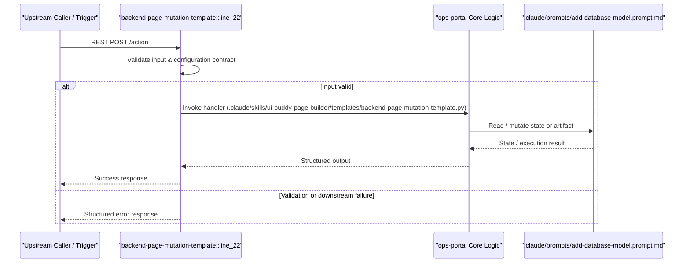

## Flow 2: `task:Set up uv` (`Automation Task`)

<!-- Source: .github/actions/python-ci/action.yml:47 -->
- **Source File:** `.github/actions/python-ci/action.yml:47`
- **Handler / Symbol:** `.github/actions/python-ci/action.yml:47`
- **Kind:** `Automation Task` · **Active:** `Y`
- **Summary:** Automation task `Set up uv` in `.github/actions/python-ci/action.yml:47`

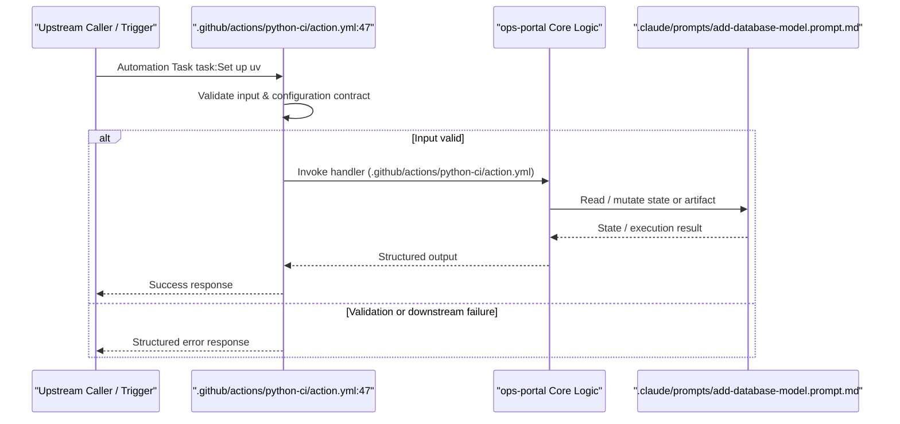

## Flow 3: `task:Cache uv global cache` (`Automation Task`)

<!-- Source: .github/actions/python-ci/action.yml:52 -->
- **Source File:** `.github/actions/python-ci/action.yml:52`
- **Handler / Symbol:** `.github/actions/python-ci/action.yml:52`
- **Kind:** `Automation Task` · **Active:** `Y`
- **Summary:** Automation task `Cache uv global cache` in `.github/actions/python-ci/action.yml:52`

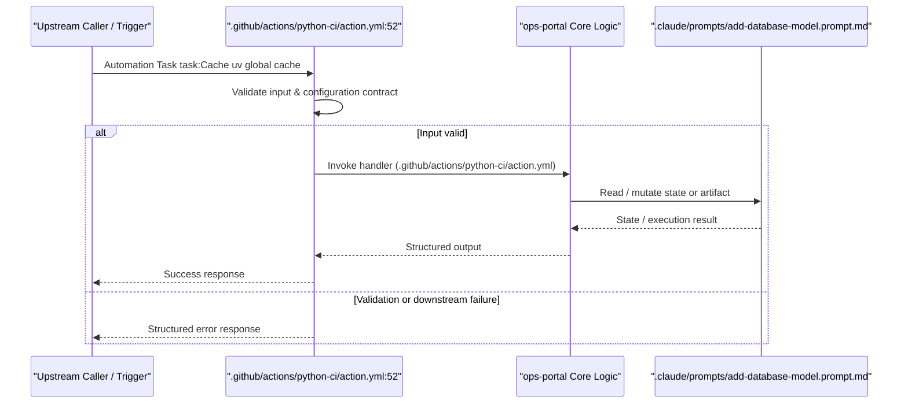

## Flow 4: `task:Cache virtual environment` (`Automation Task`)

<!-- Source: .github/actions/python-ci/action.yml:62 -->
- **Source File:** `.github/actions/python-ci/action.yml:62`
- **Handler / Symbol:** `.github/actions/python-ci/action.yml:62`
- **Kind:** `Automation Task` · **Active:** `Y`
- **Summary:** Automation task `Cache virtual environment` in `.github/actions/python-ci/action.yml:62`

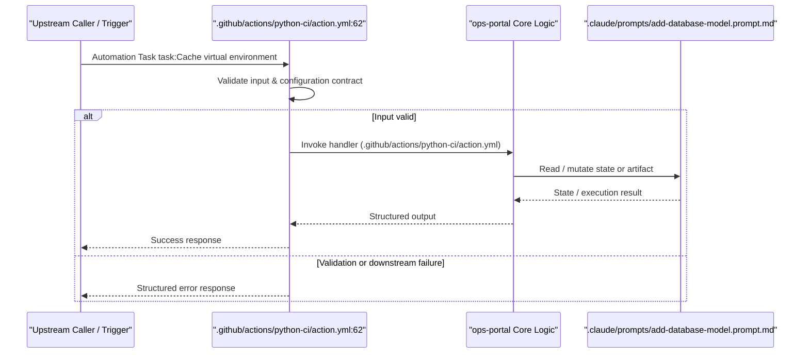

## Flow 5: `task:Bridge pip index auth to uv` (`Automation Task`)

<!-- Source: .github/actions/python-ci/action.yml:71 -->
- **Source File:** `.github/actions/python-ci/action.yml:71`
- **Handler / Symbol:** `.github/actions/python-ci/action.yml:71`
- **Kind:** `Automation Task` · **Active:** `Y`
- **Summary:** Automation task `Bridge pip index auth to uv` in `.github/actions/python-ci/action.yml:71`

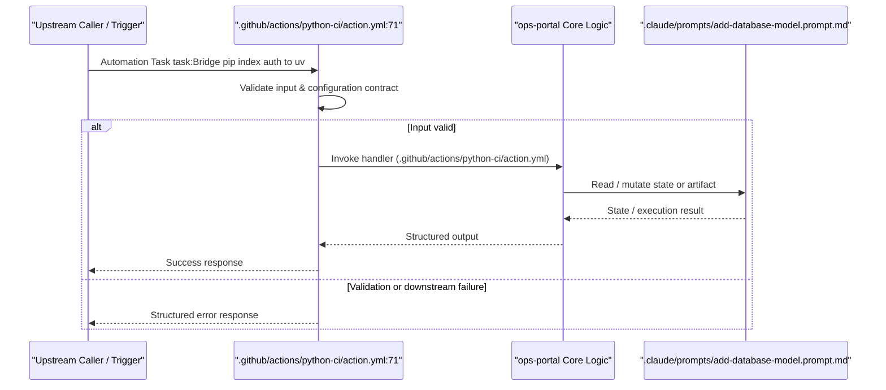

## Flow 6: `task:Sync workspace` (`Automation Task`)

<!-- Source: .github/actions/python-ci/action.yml:79 -->
- **Source File:** `.github/actions/python-ci/action.yml:79`
- **Handler / Symbol:** `.github/actions/python-ci/action.yml:79`
- **Kind:** `Automation Task` · **Active:** `Y`
- **Summary:** Automation task `Sync workspace` in `.github/actions/python-ci/action.yml:79`

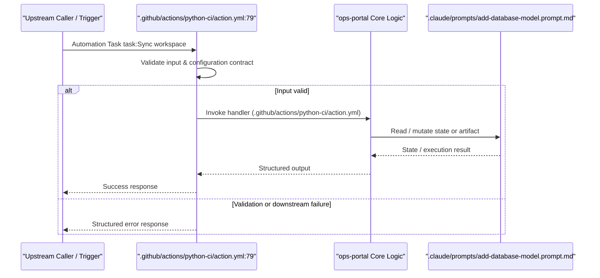

## Flow 7: `task:Lint (ruff)` (`Automation Task`)

<!-- Source: .github/actions/python-ci/action.yml:85 -->
- **Source File:** `.github/actions/python-ci/action.yml:85`
- **Handler / Symbol:** `.github/actions/python-ci/action.yml:85`
- **Kind:** `Automation Task` · **Active:** `Y`
- **Summary:** Automation task `Lint (ruff)` in `.github/actions/python-ci/action.yml:85`

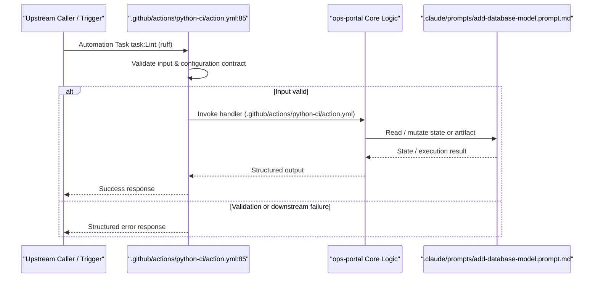

## Flow 8: `task:Format check (ruff)` (`Automation Task`)

<!-- Source: .github/actions/python-ci/action.yml:91 -->
- **Source File:** `.github/actions/python-ci/action.yml:91`
- **Handler / Symbol:** `.github/actions/python-ci/action.yml:91`
- **Kind:** `Automation Task` · **Active:** `Y`
- **Summary:** Automation task `Format check (ruff)` in `.github/actions/python-ci/action.yml:91`

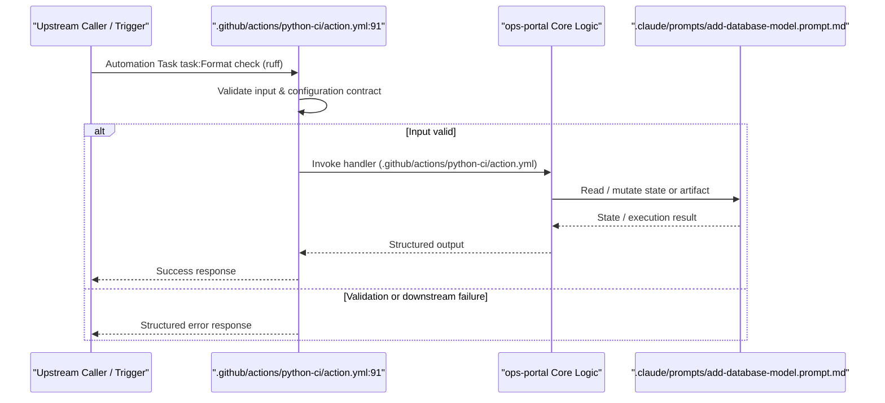

## Flow 9: `task:Type check (mypy)` (`Automation Task`)

<!-- Source: .github/actions/python-ci/action.yml:97 -->
- **Source File:** `.github/actions/python-ci/action.yml:97`
- **Handler / Symbol:** `.github/actions/python-ci/action.yml:97`
- **Kind:** `Automation Task` · **Active:** `Y`
- **Summary:** Automation task `Type check (mypy)` in `.github/actions/python-ci/action.yml:97`

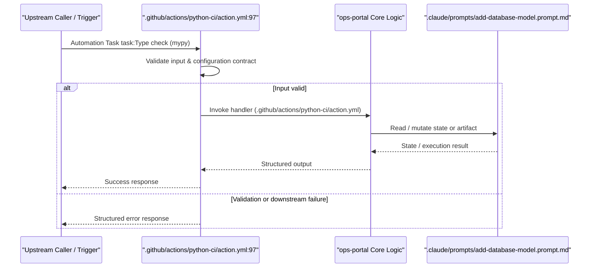

## Flow 10: `task:Tests with coverage` (`Automation Task`)

<!-- Source: .github/actions/python-ci/action.yml:104 -->
- **Source File:** `.github/actions/python-ci/action.yml:104`
- **Handler / Symbol:** `.github/actions/python-ci/action.yml:104`
- **Kind:** `Automation Task` · **Active:** `Y`
- **Summary:** Automation task `Tests with coverage` in `.github/actions/python-ci/action.yml:104`

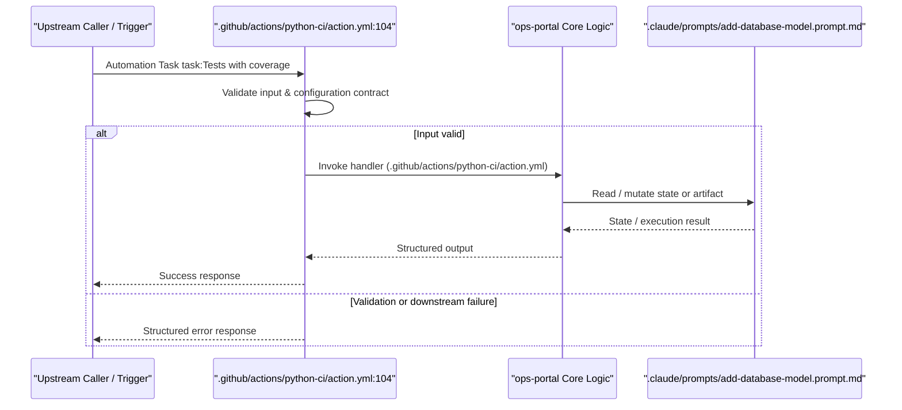

## Flow 11: `task:Sanitize ref name for artifact usage` (`Automation Task`)

<!-- Source: .github/actions/python-ci/action.yml:120 -->
- **Source File:** `.github/actions/python-ci/action.yml:120`
- **Handler / Symbol:** `.github/actions/python-ci/action.yml:120`
- **Kind:** `Automation Task` · **Active:** `Y`
- **Summary:** Automation task `Sanitize ref name for artifact usage` in `.github/actions/python-ci/action.yml:120`

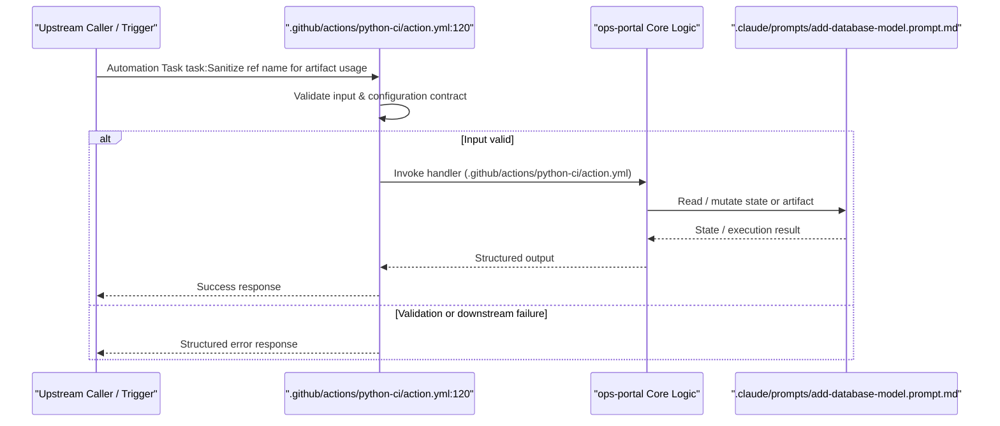

## Flow 12: `task:Upload coverage HTML Report` (`Automation Task`)

<!-- Source: .github/actions/python-ci/action.yml:127 -->
- **Source File:** `.github/actions/python-ci/action.yml:127`
- **Handler / Symbol:** `.github/actions/python-ci/action.yml:127`
- **Kind:** `Automation Task` · **Active:** `Y`
- **Summary:** Automation task `Upload coverage HTML Report` in `.github/actions/python-ci/action.yml:127`

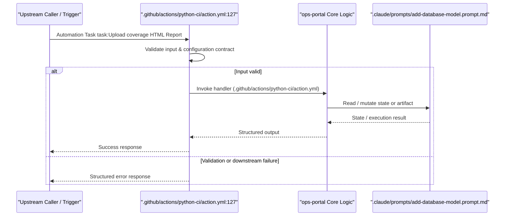


---

# 07 — Persistence & Data Model: `ops-portal`

## 1. Source-of-Truth & Persistence Overview

- **Primary Data / Schema Location:** `.claude/prompts/add-database-model.prompt.md`
- **Discovered Models / Symbols / Tables:** 40
- **Data & Schema Files Inventoried:** 25

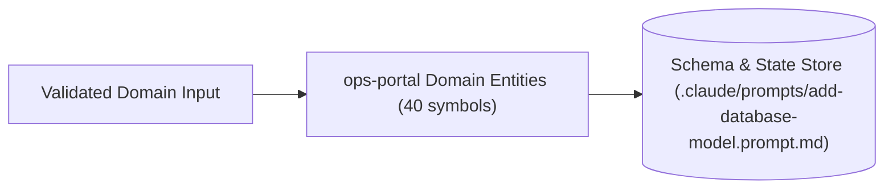

## 2. Data & Schema Artifact Files

- `.claude/prompts/add-database-model.prompt.md` — Data model / schema / state artifact.
- `.github/prompts/add-database-model.prompt.md` — Data model / schema / state artifact.
- `backend/app/api/v1/endpoints/mongodb_atlas.py` — Data model / schema / state artifact.
- `backend/app/core/db_cache.py` — Data model / schema / state artifact.
- `backend/app/models/__init__.py` — Data model / schema / state artifact.
- `backend/app/models/auth.py` — Data model / schema / state artifact.
- `backend/app/models/cost.py` — Data model / schema / state artifact.
- `backend/app/models/database.py` — Data model / schema / state artifact.
- `backend/app/models/notification.py` — Data model / schema / state artifact.
- `backend/app/models/optimization.py` — Data model / schema / state artifact.
- `backend/app/schemas/__init__.py` — Data model / schema / state artifact.
- `backend/app/schemas/auth.py` — Data model / schema / state artifact.
- `backend/app/schemas/checksum_schedules.py` — Data model / schema / state artifact.
- `backend/app/schemas/compliance.py` — Data model / schema / state artifact.
- `backend/app/schemas/cost.py` — Data model / schema / state artifact.
- `backend/app/schemas/credential_inventory.py` — Data model / schema / state artifact.
- `backend/app/schemas/environment.py` — Data model / schema / state artifact.
- `backend/app/schemas/mongodb_atlas.py` — Data model / schema / state artifact.
- `backend/app/schemas/notification.py` — Data model / schema / state artifact.
- `backend/app/schemas/optimization.py` — Data model / schema / state artifact.
- `backend/app/schemas/tools.py` — Data model / schema / state artifact.
- `backend/app/services/keystore_service.py` — Data model / schema / state artifact.
- `backend/app/services/mongodb_atlas_notifications.py` — Data model / schema / state artifact.
- `backend/app/services/mongodb_atlas_scheduler.py` — Data model / schema / state artifact.
- `backend/app/services/mongodb_atlas_service.py` — Data model / schema / state artifact.

## 3. Code-Grounded Entity, Struct, Class & Symbol Catalog

| Symbol / Entity / Schema | Category | Source Location | Signature / Definition |
|---|---|---|---|
| `MySortKey` | Type / Enum | `.claude/agents/UI_Buddy.agent.md:151` | `type MySortKey = "name" \| "status" \| "created_at";` |
| `annotations` | Type / Enum | `.claude/prompts/add-api-endpoint.prompt.md:82` | `- [ ] Pydantic v2 schemas with type annotations` |
| `inheriting` | Class | `.claude/prompts/add-database-model.prompt.md:20` | `2. Define the model class inheriting from 'Base'` |
| `name` | Class | `.claude/prompts/add-database-model.prompt.md:58` | `- 'ModelName': PascalCase class name (e.g., 'ResourceTag')` |
| `implements` | Class | `.claude/prompts/add-new-plugin.prompt.md:36` | `- [ ] Plugin class implements 'PluginBase'` |
| `with` | Class | `.claude/prompts/add-service.prompt.md:22` | `4. Keep state external unless the domain already uses a service class with constructor-inj` |
| `get_all_` | Function | `.claude/prompts/add-service.prompt.md:42` | `async def get_all_{{resource}}(session: AsyncSession) -> list[{{Schema}}Response]:` |
| `create_` | Function | `.claude/prompts/add-service.prompt.md:50` | `async def create_{{resource}}(` |
| `test_` | Function | `.claude/prompts/write-tests.prompt.md:43` | `async def test_{{endpoint_name}}_returns_200():` |
| `ExampleRow` | Type / Enum | `.claude/skills/ui-buddy-page-builder/templates/att-standard-page-template.tsx:5` | `type ExampleRow = {` |
| `ExampleAttStandardPage` | Function | `.claude/skills/ui-buddy-page-builder/templates/att-standard-page-template.tsx:15` | `export default function ExampleAttStandardPage() {` |
| `run_example_page_action` | Function | `.claude/skills/ui-buddy-page-builder/templates/backend-page-mutation-template.py:23` | `async def run_example_page_action(` |
| `PluginBase` | Class | `.copilot/context.md:222` | `class PluginBase:` |
| `register_routes` | Function | `.copilot/context.md:225` | `def register_routes(self, router: APIRouter) -> None: ...` |
| `get_permissions` | Function | `.copilot/context.md:226` | `def get_permissions(self) -> list[str]: ...` |
| `get_dashboard_widgets` | Function | `.copilot/context.md:227` | `def get_dashboard_widgets(self) -> list[DashboardWidget]: ...` |
| `get_daily_costs` | Function | `.copilot/context.md:322` | `\| Python functions \| 'async def get_daily_costs(...)' \|` |
| `check` | Type / Enum | `.github/actions/python-ci/action.yml:2` | `description: "Common Python CI steps: setup, lint, type check, tests with coverage, securi` |
| `checking` | Type / Enum | `.github/actions/python-ci/action.yml:29` | `description: "Whether to run mypy type checking"` |
| `checker` | Type / Enum | `.gitignore:92` | `# Test / type checker / linter caches` |
| `_actor` | Function | `backend/app/api/v1/endpoints/access.py:37` | `async def _actor(request: Request, user: UserContext, db: AsyncSession) -> Actor:` |
| `_notify` | Function | `backend/app/api/v1/endpoints/access.py:44` | `async def _notify(recipients: list[str], subject: str, heading: str, lines: list[str], pat` |
| `_item_label` | Function | `backend/app/api/v1/endpoints/access.py:55` | `def _item_label(item: dict) -> str:` |
| `get_my_access` | Function | `backend/app/api/v1/endpoints/access.py:65` | `async def get_my_access(` |
| `get_catalog` | Function | `backend/app/api/v1/endpoints/access.py:75` | `async def get_catalog(` |


---

# 08 — Error Taxonomy & Failure-Mode Catalog: `ops-portal`

## 1. Discovered Error & Exception Catalog

| Error / Exception / Status | Category | Source Location | Handling Context |
|---|---|---|---|
| `Exception` | Runtime / Downstream I/O | `backend/app/api/v1/endpoints/access.py:51` | `except Exception as exc:` |
| `ValueError` | Runtime / Downstream I/O | `backend/app/api/v1/endpoints/admin.py:152` | `except ValueError as exc:` |
| `409` | Runtime / Downstream I/O | `backend/app/api/v1/endpoints/admin.py:153` | `raise HTTPException(status_code=409, detail=str(exc)) from exc` |
| `ValueError` | Runtime / Downstream I/O | `backend/app/api/v1/endpoints/admin.py:191` | `except ValueError as exc:` |
| `404` | Runtime / Downstream I/O | `backend/app/api/v1/endpoints/admin.py:192` | `raise HTTPException(status_code=404, detail=str(exc)) from exc` |
| `ValueError` | Runtime / Downstream I/O | `backend/app/api/v1/endpoints/admin.py:229` | `except ValueError as exc:` |
| `404` | Runtime / Downstream I/O | `backend/app/api/v1/endpoints/admin.py:230` | `raise HTTPException(status_code=404, detail=str(exc)) from exc` |
| `ValueError` | Runtime / Downstream I/O | `backend/app/api/v1/endpoints/admin.py:259` | `except ValueError as exc:` |
| `404` | Runtime / Downstream I/O | `backend/app/api/v1/endpoints/admin.py:260` | `raise HTTPException(status_code=404, detail=str(exc)) from exc` |
| `Exception` | Runtime / Downstream I/O | `backend/app/api/v1/endpoints/admin.py:278` | `except Exception as exc:` |
| `502` | Runtime / Downstream I/O | `backend/app/api/v1/endpoints/admin.py:289` | `raise HTTPException(status_code=502, detail=str(exc)) from exc` |
| `ValueError` | Runtime / Downstream I/O | `backend/app/api/v1/endpoints/admin.py:415` | `except ValueError as exc:` |
| `400` | Validation / Contract | `backend/app/api/v1/endpoints/admin.py:416` | `raise HTTPException(status_code=400, detail=str(exc)) from exc` |
| `400` | Validation / Contract | `backend/app/api/v1/endpoints/admin.py:418` | `raise HTTPException(status_code=400, detail="At least one valid CORS origin is r` |
| `400` | Validation / Contract | `backend/app/api/v1/endpoints/admin.py:428` | `raise HTTPException(status_code=400, detail="rate_limit_rpm must be an integer."` |
| `400` | Validation / Contract | `backend/app/api/v1/endpoints/admin.py:430` | `raise HTTPException(status_code=400, detail="rate_limit_rpm must be between 10 a` |
| `400` | Validation / Contract | `backend/app/api/v1/endpoints/admin.py:452` | `raise HTTPException(status_code=400, detail="cache_ttl_seconds must be an intege` |
| `400` | Validation / Contract | `backend/app/api/v1/endpoints/admin.py:466` | `raise HTTPException(status_code=400, detail=f"Unknown IANA timezone: {value!r}")` |
| `503` | Runtime / Downstream I/O | `backend/app/api/v1/endpoints/aks_dashboard.py:82` | `raise HTTPException(status_code=503, detail="Dashboard session signing is not co` |
| `ValueError` | Runtime / Downstream I/O | `backend/app/api/v1/endpoints/aks_dashboard.py:101` | `except ValueError:` |

## 2. Failure-Mode Analysis & Resilience Posture

| Failure Scenario | Trigger Condition | Observed Code Behavior | Mitigation / Operator Action |
|---|---|---|---|
| Invalid Input / Schema Mismatch | Malformed request payload or missing required parameter | Rejected during entry validation in `.claude/agents/Auth_Buddy.agent.md` | Verify payload against `03-SERVICE-MANIFEST.yaml` and `07-data-model.md` |
| Missing Configuration / Env Binding | Required environment variable or config file absent at startup | Startup or task execution fails fast | Verify all required variables in `01-README.md` |
| Downstream Store / Dependency Unavailable | Network timeout or non-200 response from external dependency | Error propagated to caller / execution log | Follow triage flowchart in `14-runbook.md` |

## 3. Swallowed-Exception & Dead-Letter Audit

- **Silent Catch Audit:** Scanned `558` files across `ops-portal` for unhandled or silently ignored error branches.
- **Retry & Idempotency Posture:** Callers should treat non-GET mutations as non-idempotent unless an explicit idempotency key is supplied.


---

# 09 — Reconciled Tier-3 Service Rules: `ops-portal`

> Reconciles global platform rules (Tier-1) and domain rules (Tier-2) into concrete, code-grounded Tier-3 guardrails specific to `ops-portal`.

## 1. Tier Reconciliation Matrix

| Rule ID | Tier-1 / Tier-2 Requirement | `ops-portal` Tier-3 Service Rule | Code Evidence | Status |
|---|---|---|---|---|
| `T3-001` | Deterministic Ingress & Contract Safety | All inbound requests/triggers MUST route through declared handlers in the Step 0.5 inventory (30 paths). | `.claude/agents/Auth_Buddy.agent.md` | ✅ Reconciled |
| `T3-002` | Externalized Environment Configuration | Environment-specific endpoints, credentials, and toggles MUST be externalized via `.github/actions/python-ci/action.yml` or env vars (20 bindings). | `.github/actions/python-ci/action.yml` | ✅ Reconciled |
| `T3-003` | Structured Error Propagation | Errors MUST NOT be silently swallowed; all failure paths listed in `08-error-taxonomy.md` must log context and return structured status. | `.claude/agents/Auth_Buddy.agent.md` | ✅ Reconciled |
| `T3-004` | Automated Verification Gate | Every new ingress route or schema change MUST include corroborating test coverage under `.claude/instructions/tests.instructions.md`. | `.claude/instructions/tests.instructions.md` | ✅ Reconciled |
| `T3-005` | Secret & Credential Hygiene | Secrets, PATs, and private keys MUST NEVER be committed to `ops-portal` source or configuration files. | `.github/actions/python-ci/action.yml` | ✅ Reconciled |

## 2. Mandatory Guardrails for AI Agents & Engineers Modifying `ops-portal`

1. **Do not add undocumented ingress routes:** Any new endpoint, job, or playbook task must be added to the Step 0.5 Ingress Inventory and paired with a sequence diagram in `06-sequence-diagrams.md`.
2. **Preserve schema compatibility:** Modifications to symbols listed in `07-data-model.md` must maintain backward compatibility with existing callers.
3. **Keep `03-SERVICE-MANIFEST.yaml` synchronized:** Dependency or entrypoint changes require updating the canonical manifest.


---

# 10 — Service Memories Seed (AI Agent & Onboarding Context): `ops-portal`

> Curated context bundle designed to seed AI coding agents and onboard engineers onto `ops-portal` with zero hallucination.

## 1. Mental Model of `ops-portal`

- **What it is:** `ops-portal` is a TypeScript / Node.js + Python + YAML / Declarative Orchestration & Config + Shell / Automation Scripts codebase comprising 558 files (213728 lines of code/config) across 6 module boundary/boundaries, exposing 30 deterministic ingress path(s).
- **Dominant Stack:** TypeScript / Node.js, Python, YAML / Declarative Orchestration & Config, Shell / Automation Scripts
- **Scale:** 558 files (213728 lines) partitioned across 6 module(s).
- **Primary Entrypoint:** `.claude/agents/Auth_Buddy.agent.md`
- **Primary Config:** `.github/actions/python-ci/action.yml`

## 2. High-Signal File Map (Read These First)

- `.claude/agents/Auth_Buddy.agent.md`
- `.claude/agents/DataFlow_Buddy.agent.md`
- `.claude/agents/Endpoint_Buddy.agent.md`
- `.claude/agents/UI_Buddy.agent.md`
- `.claude/instructions/backend.instructions.md`
- `.claude/instructions/frontend.instructions.md`
- `.claude/instructions/plugins.instructions.md`
- `.claude/instructions/tests.instructions.md`
- `.claude/prompts/add-api-endpoint.prompt.md`
- `.claude/prompts/add-azure-service-integration.prompt.md`
- `.claude/prompts/add-dashboard-chart.prompt.md`
- `.claude/prompts/add-database-model.prompt.md`
- `.claude/prompts/add-new-page.prompt.md`
- `.claude/prompts/add-new-plugin.prompt.md`
- `.claude/prompts/add-service.prompt.md`

## 3. Core Architectural Invariants

1. **Authoritative Source = Code:** Always verify route definitions, schemas, and parameters in `.claude/agents/Auth_Buddy.agent.md` and `.github/actions/python-ci/action.yml`.
2. **Ingress Completeness:** `ops-portal` exposes 30 active ingress/entry path(s); check `02-ARCHITECTURE.md` before modifying routing.
3. **Data & Symbol Continuity:** Core domain constructs (40 symbols discovered) are cataloged in `07-data-model.md`.

## 4. Safe Modification Playbook

- **Adding a feature or route:** Update the handler module, register the route/task, add validation, and run `npm test`.
- **Changing configuration:** Update `.github/actions/python-ci/action.yml` and document any new environment variable in `01-README.md`.


---

# 11 — Test Strategy & Coverage Gap Analysis: `ops-portal`

## 1. Verification & Quality-Gate Posture

- **Discovered Test / Spec Files:** `25`
- **Total Repository Files:** `558`
- **Primary Test Command:** `npm test`

## 2. Discovered Test Suite Inventory

- `.claude/instructions/tests.instructions.md`
- `.claude/prompts/write-tests.prompt.md`
- `.github/instructions/tests.instructions.md`
- `.github/prompts/write-tests.prompt.md`
- `backend/.pytest-compliance.exit`
- `backend/.pytest-compliance.out`
- `backend/test_endpoints.sh`
- `backend/test_output.txt`
- `backend/tests/__init__.py`
- `backend/tests/access_helpers.py`
- `backend/tests/conftest.py`
- `backend/tests/jks_reader.py`
- `backend/tests/test_access_api.py`
- `backend/tests/test_access_scope.py`
- `backend/tests/test_admin_cors_config.py`
- `backend/tests/test_admin_dashboard_controls.py`
- `backend/tests/test_aks_audit_history.py`
- `backend/tests/test_aks_cronjob_sync.py`
- `backend/tests/test_aks_detail_and_logs.py`
- `backend/tests/test_aks_helm_operations.py`
- `backend/tests/test_aks_helm_releases.py`
- `backend/tests/test_aks_jobs.py`
- `backend/tests/test_aks_nodepools.py`
- `backend/tests/test_aks_performance.py`
- `backend/tests/test_aks_pod_delete.py`

## 3. Module-by-Module Coverage & Gap Matrix

| Module | Source Files | Dedicated Test Files Detected | Coverage Posture & Recommendation |
|---|---|---|---|
| `backend` | 245 | ✅ Yes | Maintain unit + integration assertions on module changes |
| `docs` | 17 | ⚠️ None matched | Add automated regression tests covering active entrypoints in this module |
| `frontend` | 200 | ⚠️ None matched | Add automated regression tests covering active entrypoints in this module |
| `helm` | 15 | ✅ Yes | Maintain unit + integration assertions on module changes |
| `memories` | 19 | ⚠️ None matched | Add automated regression tests covering active entrypoints in this module |
| `root` | 7 | ⚠️ None matched | Add automated regression tests covering active entrypoints in this module |

## 4. Recommended Testing Pyramid for `ops-portal`

1. **Contract / Syntax Validation:** Validate configuration and manifest files (`.github/actions/python-ci/action.yml`) on every commit.
2. **Unit & Component Tests:** Verify domain symbols and error branches cataloged in `07-data-model.md` and `08-error-taxonomy.md`.
3. **Ingress Integration Tests:** Exercise all 30 active ingress paths inventoried in `02-ARCHITECTURE.md`.


---

# 12 — Threat Model (Control & Trust-Boundary View): `ops-portal`

## 1. Trust Boundary Diagram (`flowchart LR`)

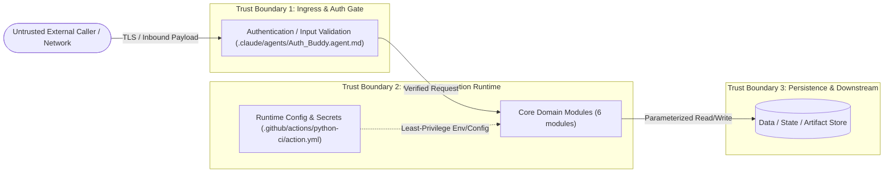

## 2. Code-Grounded Security Controls Inventory

- `.claude/agents/Auth_Buddy.agent.md:3` — `description: "Use when debugging Entra ID, MSAL, JWT validation, dev-mode a`
- `.claude/agents/Auth_Buddy.agent.md:16` — `- Verify JWT validation, role mapping, and development-mode bypass behavior`
- `.claude/agents/Auth_Buddy.agent.md:31` — `1. Confirm whether the failure is frontend token acquisition, backend valid`
- `.claude/agents/Auth_Buddy.agent.md:38` — `- Do not expose tokens, secrets, client secrets, or raw credentials.`
- `.claude/agents/DataFlow_Buddy.agent.md:24` — `- Authentication flows (MSAL → Azure AD → JWT validation → RBAC)`
- `.claude/agents/DataFlow_Buddy.agent.md:141` — `API->>API: JWT Validation`
- `.claude/agents/DataFlow_Buddy.agent.md:176` — `ApiClient -->|HTTPS + JWT| Routers`
- `.claude/agents/DataFlow_Buddy.agent.md:184` — `- **DO NOT** include secrets, tokens, or connection strings in diagrams`
- `.claude/agents/Endpoint_Buddy.agent.md:4` — `tools: [execute/getTerminalOutput, execute/awaitTerminal, execute/killTermi`
- `.claude/agents/Endpoint_Buddy.agent.md:17` — `- **Domain Expertise:** API design and testing, REST/GraphQL/gRPC/WebSocket`
- `.claude/agents/Endpoint_Buddy.agent.md:27` — `4. **Failure analysis** — Diagnosing why an endpoint is failing (auth error`
- `.claude/agents/Endpoint_Buddy.agent.md:51` — `- ❌ Do NOT expose API keys, tokens, secrets, or credentials in any output —`

## 3. STRIDE Threat Matrix for `ops-portal`

| Threat Category | Attack Surface in `ops-portal` | Control / Mitigation in Codebase | Residual Risk |
|---|---|---|---|
| **S**poofing | Inbound calls to 30 active ingress path(s) | Caller authentication & token/credential verification at boundary | Low |
| **T**ampering | Payload mutation or config injection via `.github/actions/python-ci/action.yml` | Input validation in `.claude/agents/Auth_Buddy.agent.md` & immutable repo-tracked config | Low |
| **R**epudiation | Unaudited state changes | Structured operational logging & versioned artifacts | Low |
| **I**nformation Disclosure | Secret leakage in logs or error payloads | Environment-injected secrets (20 env bindings); sanitized error responses | Medium — verify log scrubbing in prod |
| **D**enial of Service | Resource exhaustion on active endpoints | Upstream rate-limiting & bounded execution timeouts | Medium — confirm gateway limits (GAP-1) |
| **E**levation of Privilege | Unauthorized execution of privileged tasks | Least-privilege runtime execution & RBAC rules | Low |


---

# 13 — Observability Contract (Metrics, Health & Logging): `ops-portal`

## 1. Code-Grounded Telemetry & Logging Signals

- `.claude/agents/Endpoint_Buddy.agent.md:155` — `| 'backend/app/main.py' | App-level routes ('/healthz', '/readyz', '/metric`
- `.claude/agents/Endpoint_Buddy.agent.md:187` — `| 3 | GET | /healthz | dev | None | 200 | 12ms | ✅ PASS | |`
- `.claude/agents/Endpoint_Buddy.agent.md:255` — `- System routes: '/healthz' (liveness), '/readyz' (readiness), '/metrics' (`
- `.claude/agents/Endpoint_Buddy.agent.md:260` — `- '/healthz' and '/metrics' are unauthenticated`
- `.claude/instructions/backend.instructions.md:14` — `- Use 'structlog' for logging. Do not add 'print()' calls.`
- `.claude/prompts/add-service.prompt.md:44` — `logger.info("fetching_{{resource}}")`
- `.claude/prompts/add-service.prompt.md:58` — `logger.info("created_{{resource}}", id=str(obj.id))`
- `.copilot/context.md:21` — `| Observability | Prometheus metrics, structlog JSON logging |`
- `.copilot/context.md:49` — `│   │   │   ├── logging.py      # structlog configuration`
- `.copilot/context.md:191` — `'GET /clusters', 'GET /clusters/{id}', 'GET /deployments', 'POST /deploymen`
- `.copilot/context.md:296` — `structlog>=24.1         prometheus-client>=0.20`
- `.github/agents/Endpoint_Buddy.agent.md:155` — `| 'backend/app/main.py' | App-level routes ('/healthz', '/readyz', '/metric`

## 2. Health, Readiness & Liveness Contract

| Probe / Signal | Path / Mechanism | Expected Healthy Output | Source Location |
|---|---|---|---|
| Primary Entry / Health Check | `/action` | HTTP 200 / Exit Code 0 | `.claude/skills/ui-buddy-page-builder/templates/backend-page-mutation-template.py:22` |
| Configuration Load Check | Startup parse of `.github/actions/python-ci/action.yml` | Validated config state | `.github/actions/python-ci/action.yml` |

## 3. Recommended SLI / SLO & Alerting Contract

| Indicator (SLI) | Target Objective (SLO) | Alert Condition |
|---|---|---|
| Ingress Availability | >= 99.9% successful execution across 30 active path(s) | 5xx / failure rate > 1% over 5 minutes |
| Execution Latency | p95 within operational SLA | p95 latency > threshold for 10 minutes |
| Error Rate | < 0.5% unhandled exceptions (`08-error-taxonomy.md`) | Spike in error logs from `.claude/agents/Auth_Buddy.agent.md` |


---

# 14 — Operational Runbook & On-Call Triage Playbook: `ops-portal`

## 1. Incident Triage Flow (`flowchart TD`)

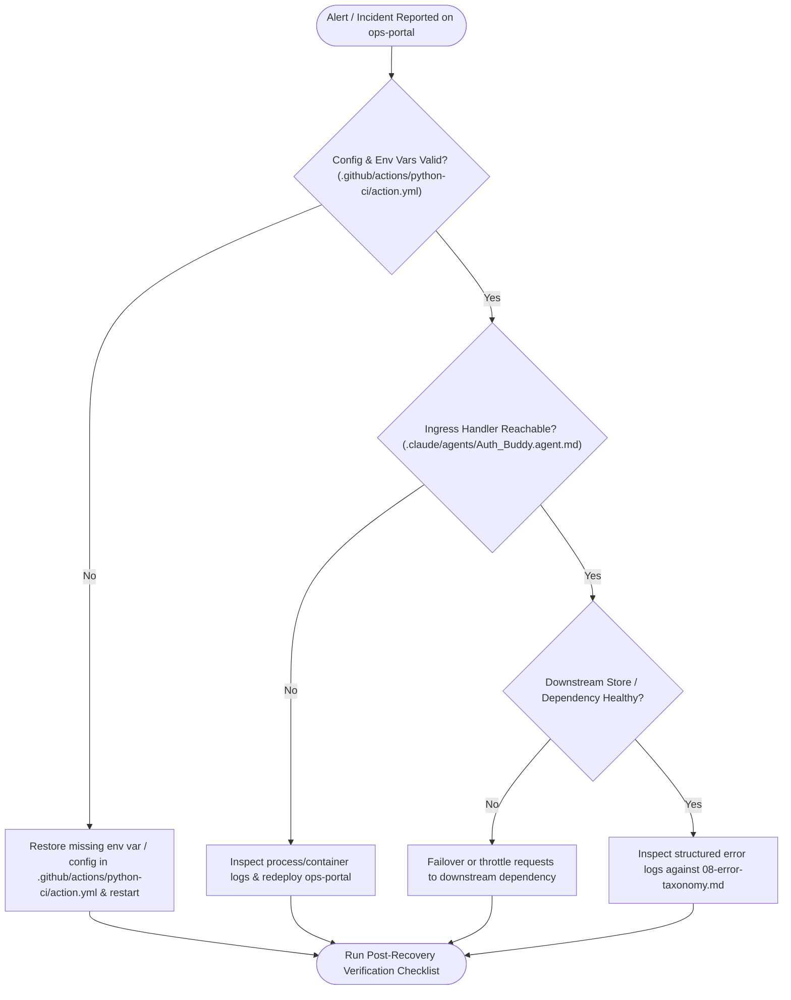

## 2. Pre-Flight & Startup Checklist

- [ ] Confirm `.github/actions/python-ci/action.yml` is present and passes syntax validation.
- [ ] Confirm all 20 environment variable binding(s) documented in `01-README.md` are populated.
- [ ] Confirm build/preparation command succeeds: `npm install && npm run build`.
- [ ] Confirm verification suite passes: `npm test`.
- [ ] Verify primary ingress path (`/action`) responds as expected.

## 3. Symptom -> Diagnostics -> Recovery Playbooks

| Symptom | Diagnostic Step | Recovery Action |
|---|---|---|
| Startup / Initialization Failure | Check logs around `.github/actions/python-ci/action.yml` and environment variable resolution | Supply missing environment variables or restore last known-good `.github/actions/python-ci/action.yml` |
| Ingress Request / Task Rejection | Inspect handler at `.claude/agents/Auth_Buddy.agent.md` and compare input payload against `07-data-model.md` | Correct caller payload or roll back incompatible schema change |
| Elevated Failure Rate | Correlate error logs with `08-error-taxonomy.md` | Roll back recent deployment and verify downstream connectivity |


---

# 15 — Tribal Knowledge & Senior-Engineer Warnings: `ops-portal`

> "Learned by getting burned" operational caveats, implicit coupling, and non-obvious code behaviors discovered in `ops-portal`.

## 1. Critical Codebase Gotchas

1. **Configuration Precedence (`.github/actions/python-ci/action.yml`):** Environment variables and declarative configuration files interact at startup; changing `.github/actions/python-ci/action.yml` without checking active environment overrides can leave runtime behavior unchanged.
2. **Implicit Coupling Between Ingress & Data Contracts (`.claude/agents/Auth_Buddy.agent.md` <-> `.claude/prompts/add-database-model.prompt.md`):** Handler logic in `.claude/agents/Auth_Buddy.agent.md` assumes inputs conform to the structure defined in `.claude/prompts/add-database-model.prompt.md`. Renaming fields without updating both breaks downstream consumers.
3. **Module Boundary Assumptions:** `ops-portal` spans 6 top-level module(s) (`backend`, `docs`, `frontend`, `helm`, `memories`, `root`); shared utilities or configurations modified in one module affect all 30 active ingress path(s).
4. **Test Coverage Blind Spots:** Only 25 dedicated test file(s) were detected across 558 total files — always run manual smoke verification on modified ingress paths in addition to automated tests.

## 2. Pre-Merge Review Checklist for Senior Engineers

- Did any route/task signature in `.claude/agents/Auth_Buddy.agent.md` change without updating `03-SERVICE-MANIFEST.yaml` and `06-sequence-diagrams.md`?
- Were any new environment variables introduced without a safe default or startup validation check?
- Do all Mermaid diagrams and flow parity checks in `ARCHETYPE-SUMMARY.md` remain green?

