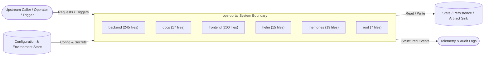

# 02 — Current-State Architecture Record: `ops-portal`

## 1. System Context & Runtime Topology

- **Service:** `ops-portal`
- **Dominant Stack(s):** TypeScript / Node.js, Python, YAML / Declarative Orchestration & Config, Shell / Automation Scripts
- **Framework / Execution Model:** `React + REST API`
- **State / Schema Boundary:** `.claude/prompts/add-database-model.prompt.md`

## 2. Internal Module & Layer Decomposition

- **Module `backend`** (245 files): Contains `backend/.env`, `backend/.env.example`, `backend/.pytest-compliance.exit`, `backend/.pytest-compliance.out`, `backend/README.md`, `backend/app/__init__.py`.
- **Module `docs`** (17 files): Contains `docs/AGENTIC_AI_CONVERSION_OPTIONS.md`, `docs/AI_PRIMITIVES.md`, `docs/AKV_ENV_SECRET_TEMPLATES.md`, `docs/ARCHITECTURE.md`, `docs/CERTIFICATE_MANAGEMENT.md`, `docs/CHECKSUM_DEPLOYMENT_GUIDE.md`.
- **Module `frontend`** (200 files): Contains `frontend/.env`, `frontend/eslint.config.js`, `frontend/index.html`, `frontend/package-lock.json`, `frontend/package.json`, `frontend/postcss.config.js`.
- **Module `helm`** (15 files): Contains `helm/ops-portal/Chart.yaml`, `helm/ops-portal/templates/_helpers.tpl`, `helm/ops-portal/templates/azure-key-vault-secret.yaml`, `helm/ops-portal/templates/backend-deployment.yaml`, `helm/ops-portal/templates/backend-service.yaml`, `helm/ops-portal/templates/frontend-deployment.yaml`.
- **Module `memories`** (19 files): Contains `memories/repo/amortized-sync-notes.md`, `memories/repo/compliance-cache-removal.md`, `memories/repo/compliance-dashboard-fix-v2.md`, `memories/repo/endpoint_buddy/alerts.md`, `memories/repo/endpoint_buddy/fixes/applied.md`, `memories/repo/endpoint_buddy/fixes/pending.md`.
- **Module `root`** (7 files): Contains `.endpoint-probe.out`, `.gitignore`, `.pre-commit-config.yaml`, `Bulk_Secret_Update_Sample.json`, `Dockerfile.backend`, `Dockerfile.frontend`.

## 3. Complete Ingress Inventory (Reconciled against Step 0.5)

Every row discovered during Step 0.5 Deterministic Ingress Inventory is represented below with its active/inactive status:

| # | Route / Trigger / Entry | Handler / Symbol | Kind | Active (Y/N) | Source Location |
|---|---|---|---|---|---|
| 1 | `/action` | `backend-page-mutation-template::line_22` | REST POST | Y | `.claude/skills/ui-buddy-page-builder/templates/backend-page-mutation-template.py:22` |
| 2 | `task:Set up uv` | `.github/actions/python-ci/action.yml:47` | Automation Task | Y | `.github/actions/python-ci/action.yml:47` |
| 3 | `task:Cache uv global cache` | `.github/actions/python-ci/action.yml:52` | Automation Task | Y | `.github/actions/python-ci/action.yml:52` |
| 4 | `task:Cache virtual environment` | `.github/actions/python-ci/action.yml:62` | Automation Task | Y | `.github/actions/python-ci/action.yml:62` |
| 5 | `task:Bridge pip index auth to uv` | `.github/actions/python-ci/action.yml:71` | Automation Task | Y | `.github/actions/python-ci/action.yml:71` |
| 6 | `task:Sync workspace` | `.github/actions/python-ci/action.yml:79` | Automation Task | Y | `.github/actions/python-ci/action.yml:79` |
| 7 | `task:Lint (ruff)` | `.github/actions/python-ci/action.yml:85` | Automation Task | Y | `.github/actions/python-ci/action.yml:85` |
| 8 | `task:Format check (ruff)` | `.github/actions/python-ci/action.yml:91` | Automation Task | Y | `.github/actions/python-ci/action.yml:91` |
| 9 | `task:Type check (mypy)` | `.github/actions/python-ci/action.yml:97` | Automation Task | Y | `.github/actions/python-ci/action.yml:97` |
| 10 | `task:Tests with coverage` | `.github/actions/python-ci/action.yml:104` | Automation Task | Y | `.github/actions/python-ci/action.yml:104` |
| 11 | `task:Sanitize ref name for artifact usage` | `.github/actions/python-ci/action.yml:120` | Automation Task | Y | `.github/actions/python-ci/action.yml:120` |
| 12 | `task:Upload coverage HTML Report` | `.github/actions/python-ci/action.yml:127` | Automation Task | Y | `.github/actions/python-ci/action.yml:127` |
| 13 | `task:Upload coverage XML Report` | `.github/actions/python-ci/action.yml:135` | Automation Task | Y | `.github/actions/python-ci/action.yml:135` |
| 14 | `task:Run bandit (security static analysis` | `.github/actions/python-ci/action.yml:143` | Automation Task | Y | `.github/actions/python-ci/action.yml:143` |
| 15 | `task:Upload bandit report` | `.github/actions/python-ci/action.yml:159` | Automation Task | Y | `.github/actions/python-ci/action.yml:159` |
| 16 | `/action` | `backend-page-mutation-template::line_22` | REST POST | Y | `.github/skills/ui-buddy-page-builder/templates/backend-page-mutation-template.py:22` |
| 17 | `/me` | `access::line_64` | REST GET | Y | `backend/app/api/v1/endpoints/access.py:64` |
| 18 | `/catalog` | `access::line_74` | REST GET | Y | `backend/app/api/v1/endpoints/access.py:74` |
| 19 | `/requests` | `access::line_95` | REST POST | Y | `backend/app/api/v1/endpoints/access.py:95` |
| 20 | `/requests/mine` | `access::line_120` | REST GET | Y | `backend/app/api/v1/endpoints/access.py:120` |
| 21 | `/requests/{request_id}/cancel` | `access::line_128` | REST POST | Y | `backend/app/api/v1/endpoints/access.py:128` |
| 22 | `/admin/projects` | `access::line_142` | REST GET | Y | `backend/app/api/v1/endpoints/access.py:142` |
| 23 | `/admin/projects` | `access::line_164` | REST POST | Y | `backend/app/api/v1/endpoints/access.py:164` |
| 24 | `/admin/projects/{project_id}` | `access::line_177` | REST GET | Y | `backend/app/api/v1/endpoints/access.py:177` |
| 25 | `/admin/projects/{project_id}` | `access::line_191` | REST DELETE | Y | `backend/app/api/v1/endpoints/access.py:191` |
| 26 | `/admin/projects/{project_id}/apps` | `access::line_215` | REST POST | Y | `backend/app/api/v1/endpoints/access.py:215` |
| 27 | `/admin/apps/{app_id}` | `access::line_234` | REST GET | Y | `backend/app/api/v1/endpoints/access.py:234` |
| 28 | `/admin/apps/{app_id}` | `access::line_248` | REST DELETE | Y | `backend/app/api/v1/endpoints/access.py:248` |
| 29 | `/admin/projects/{project_id}/admins` | `access::line_263` | REST POST | Y | `backend/app/api/v1/endpoints/access.py:263` |
| 30 | `/admin/projects/{project_id}/admins/{user_id}` | `access::line_275` | REST DELETE | Y | `backend/app/api/v1/endpoints/access.py:275` |

## 4. Architectural Constraints & Runtime Invariants

1. **Configuration Isolation:** Runtime settings originate from `.github/actions/python-ci/action.yml` and environment bindings; hardcoded environment promotion values are prohibited.
2. **Deterministic Ingress Routing:** All inbound traffic or execution triggers enter through the 30 documented ingress path(s) above.
3. **Explicit Module Boundaries:** Responsibilities are partitioned across 6 top-level module(s) with 558 total source/configuration files.
