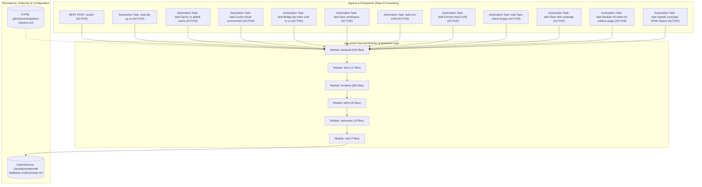

# 05 — Internal Component Diagram: `ops-portal`

## 1. Component Architecture & Wiring (`flowchart TB`)

Every active and inactive ingress path from the Step 0.5 Ingress Inventory is represented below and wired to `ops-portal` internal modules and backing stores:

## 2. Component-to-Sequence Flow Parity Table

| # | Ingress Path | Node in `05-component-diagram.md` | Sequence Diagram in `06-sequence-diagrams.md` | Status |
|---|---|---|---|---|
| 1 | `/action` | `ING_0` | Flow #1 (`backend-page-mutation-template::line_22`) | ✅ |
| 2 | `task:Set up uv` | `ING_1` | Flow #2 (`.github/actions/python-ci/action.yml:47`) | ✅ |
| 3 | `task:Cache uv global cache` | `ING_2` | Flow #3 (`.github/actions/python-ci/action.yml:52`) | ✅ |
| 4 | `task:Cache virtual environment` | `ING_3` | Flow #4 (`.github/actions/python-ci/action.yml:62`) | ✅ |
| 5 | `task:Bridge pip index auth to uv` | `ING_4` | Flow #5 (`.github/actions/python-ci/action.yml:71`) | ✅ |
| 6 | `task:Sync workspace` | `ING_5` | Flow #6 (`.github/actions/python-ci/action.yml:79`) | ✅ |
| 7 | `task:Lint (ruff)` | `ING_6` | Flow #7 (`.github/actions/python-ci/action.yml:85`) | ✅ |
| 8 | `task:Format check (ruff)` | `ING_7` | Flow #8 (`.github/actions/python-ci/action.yml:91`) | ✅ |
| 9 | `task:Type check (mypy)` | `ING_8` | Flow #9 (`.github/actions/python-ci/action.yml:97`) | ✅ |
| 10 | `task:Tests with coverage` | `ING_9` | Flow #10 (`.github/actions/python-ci/action.yml:104`) | ✅ |
| 11 | `task:Sanitize ref name for artifact usage` | `ING_10` | Flow #11 (`.github/actions/python-ci/action.yml:120`) | ✅ |
| 12 | `task:Upload coverage HTML Report` | `ING_11` | Flow #12 (`.github/actions/python-ci/action.yml:127`) | ✅ |

