# 06 — Sequence Diagrams (One per Ingress Path): `ops-portal`

> Per `orchestrate.agent.md`, each active ingress path in the Step 0.5 Ingress Inventory has its own dedicated `sequenceDiagram`. Unrelated flows are never consolidated.

## Flow 1: `/action` (`REST POST`)

<!-- Source: .claude/skills/ui-buddy-page-builder/templates/backend-page-mutation-template.py:22 -->
- **Source File:** `.claude/skills/ui-buddy-page-builder/templates/backend-page-mutation-template.py:22`
- **Handler / Symbol:** `backend-page-mutation-template::line_22`
- **Kind:** `REST POST` · **Active:** `Y`
- **Summary:** REST POST endpoint `/action` handled in `.claude/skills/ui-buddy-page-builder/templates/backend-page-mutation-template.py:22`

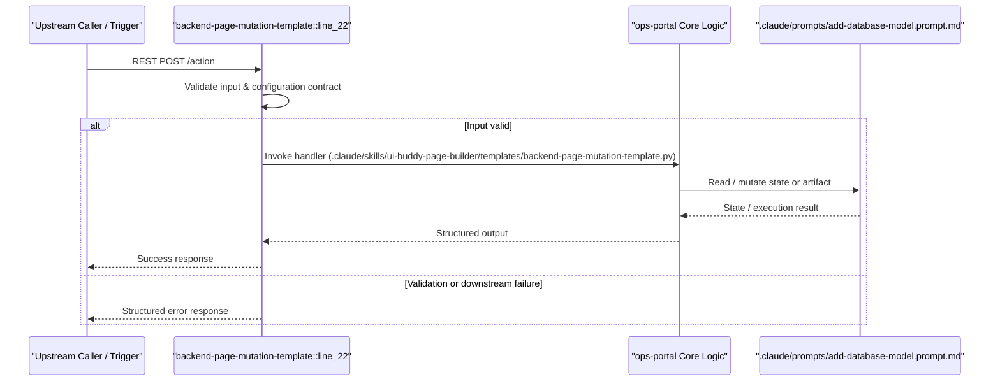

## Flow 2: `task:Set up uv` (`Automation Task`)

<!-- Source: .github/actions/python-ci/action.yml:47 -->
- **Source File:** `.github/actions/python-ci/action.yml:47`
- **Handler / Symbol:** `.github/actions/python-ci/action.yml:47`
- **Kind:** `Automation Task` · **Active:** `Y`
- **Summary:** Automation task `Set up uv` in `.github/actions/python-ci/action.yml:47`

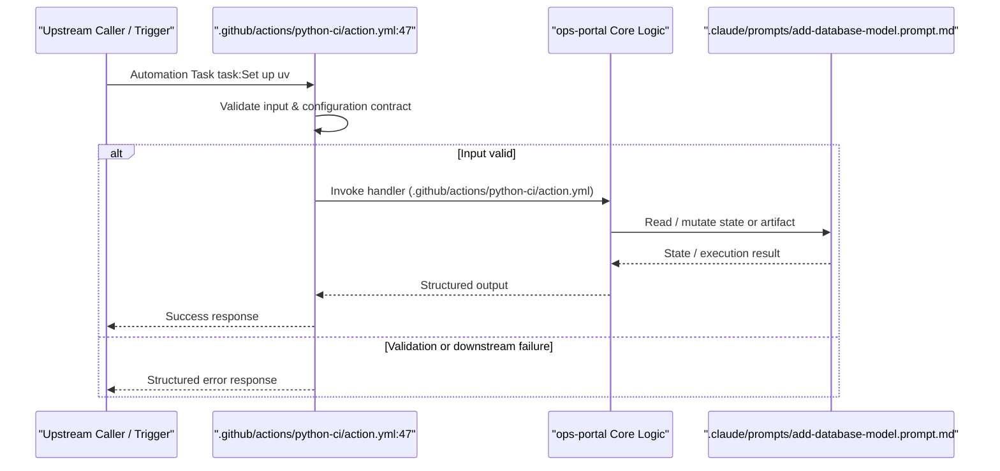

## Flow 3: `task:Cache uv global cache` (`Automation Task`)

<!-- Source: .github/actions/python-ci/action.yml:52 -->
- **Source File:** `.github/actions/python-ci/action.yml:52`
- **Handler / Symbol:** `.github/actions/python-ci/action.yml:52`
- **Kind:** `Automation Task` · **Active:** `Y`
- **Summary:** Automation task `Cache uv global cache` in `.github/actions/python-ci/action.yml:52`

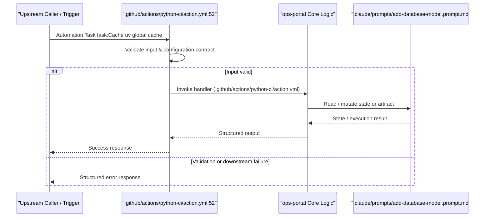

## Flow 4: `task:Cache virtual environment` (`Automation Task`)

<!-- Source: .github/actions/python-ci/action.yml:62 -->
- **Source File:** `.github/actions/python-ci/action.yml:62`
- **Handler / Symbol:** `.github/actions/python-ci/action.yml:62`
- **Kind:** `Automation Task` · **Active:** `Y`
- **Summary:** Automation task `Cache virtual environment` in `.github/actions/python-ci/action.yml:62`

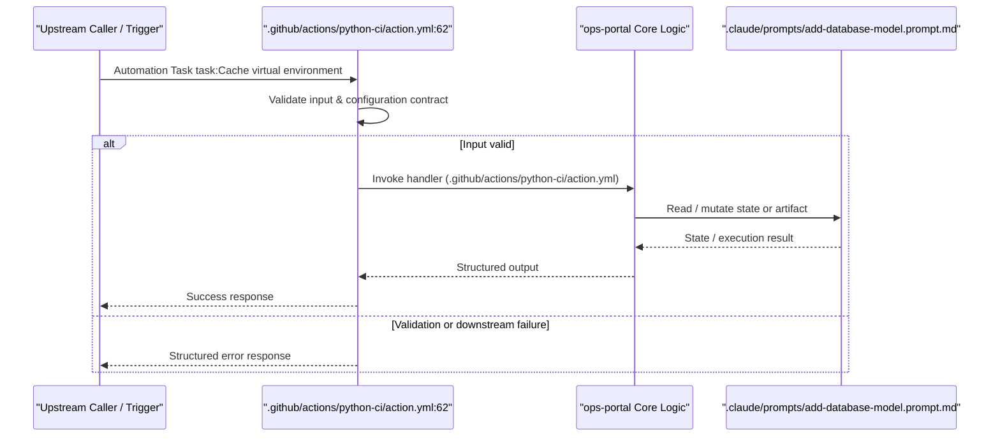

## Flow 5: `task:Bridge pip index auth to uv` (`Automation Task`)

<!-- Source: .github/actions/python-ci/action.yml:71 -->
- **Source File:** `.github/actions/python-ci/action.yml:71`
- **Handler / Symbol:** `.github/actions/python-ci/action.yml:71`
- **Kind:** `Automation Task` · **Active:** `Y`
- **Summary:** Automation task `Bridge pip index auth to uv` in `.github/actions/python-ci/action.yml:71`

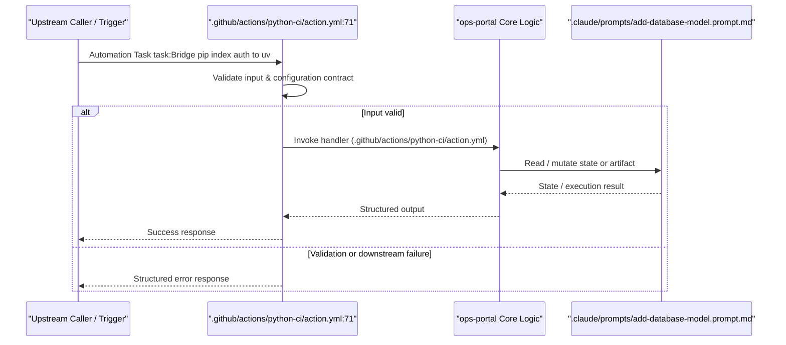

## Flow 6: `task:Sync workspace` (`Automation Task`)

<!-- Source: .github/actions/python-ci/action.yml:79 -->
- **Source File:** `.github/actions/python-ci/action.yml:79`
- **Handler / Symbol:** `.github/actions/python-ci/action.yml:79`
- **Kind:** `Automation Task` · **Active:** `Y`
- **Summary:** Automation task `Sync workspace` in `.github/actions/python-ci/action.yml:79`

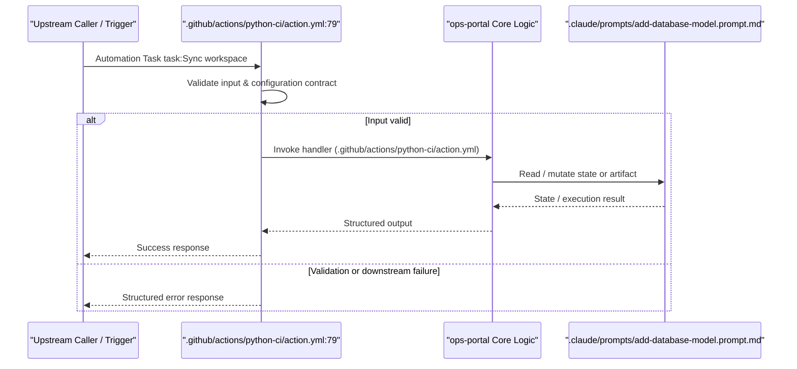

## Flow 7: `task:Lint (ruff)` (`Automation Task`)

<!-- Source: .github/actions/python-ci/action.yml:85 -->
- **Source File:** `.github/actions/python-ci/action.yml:85`
- **Handler / Symbol:** `.github/actions/python-ci/action.yml:85`
- **Kind:** `Automation Task` · **Active:** `Y`
- **Summary:** Automation task `Lint (ruff)` in `.github/actions/python-ci/action.yml:85`

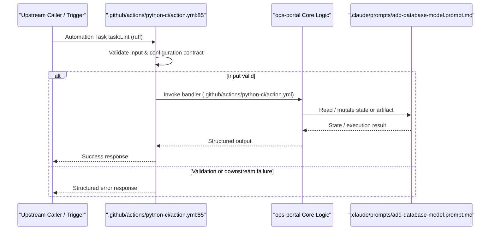

## Flow 8: `task:Format check (ruff)` (`Automation Task`)

<!-- Source: .github/actions/python-ci/action.yml:91 -->
- **Source File:** `.github/actions/python-ci/action.yml:91`
- **Handler / Symbol:** `.github/actions/python-ci/action.yml:91`
- **Kind:** `Automation Task` · **Active:** `Y`
- **Summary:** Automation task `Format check (ruff)` in `.github/actions/python-ci/action.yml:91`

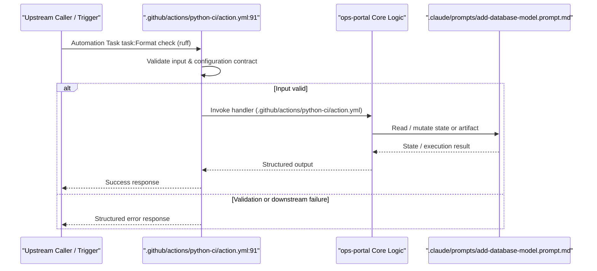

## Flow 9: `task:Type check (mypy)` (`Automation Task`)

<!-- Source: .github/actions/python-ci/action.yml:97 -->
- **Source File:** `.github/actions/python-ci/action.yml:97`
- **Handler / Symbol:** `.github/actions/python-ci/action.yml:97`
- **Kind:** `Automation Task` · **Active:** `Y`
- **Summary:** Automation task `Type check (mypy)` in `.github/actions/python-ci/action.yml:97`

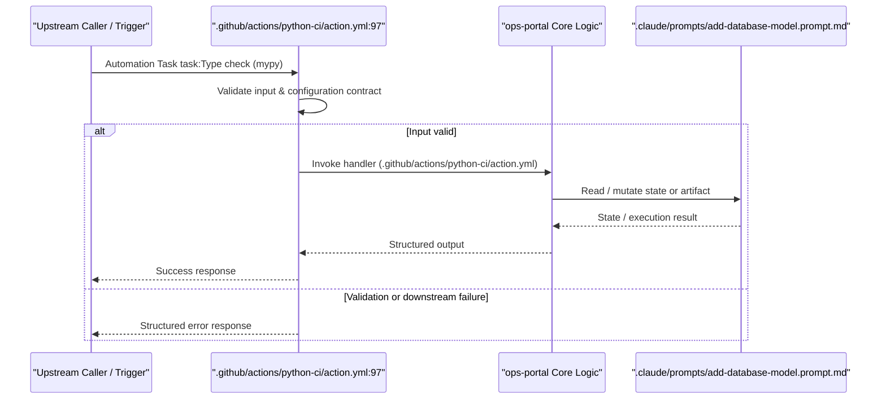

## Flow 10: `task:Tests with coverage` (`Automation Task`)

<!-- Source: .github/actions/python-ci/action.yml:104 -->
- **Source File:** `.github/actions/python-ci/action.yml:104`
- **Handler / Symbol:** `.github/actions/python-ci/action.yml:104`
- **Kind:** `Automation Task` · **Active:** `Y`
- **Summary:** Automation task `Tests with coverage` in `.github/actions/python-ci/action.yml:104`

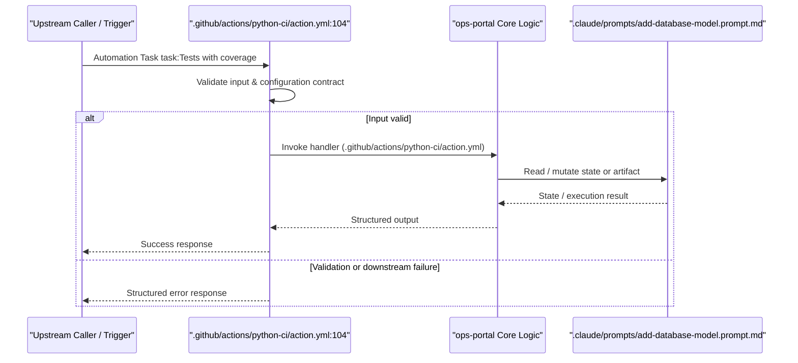

## Flow 11: `task:Sanitize ref name for artifact usage` (`Automation Task`)

<!-- Source: .github/actions/python-ci/action.yml:120 -->
- **Source File:** `.github/actions/python-ci/action.yml:120`
- **Handler / Symbol:** `.github/actions/python-ci/action.yml:120`
- **Kind:** `Automation Task` · **Active:** `Y`
- **Summary:** Automation task `Sanitize ref name for artifact usage` in `.github/actions/python-ci/action.yml:120`

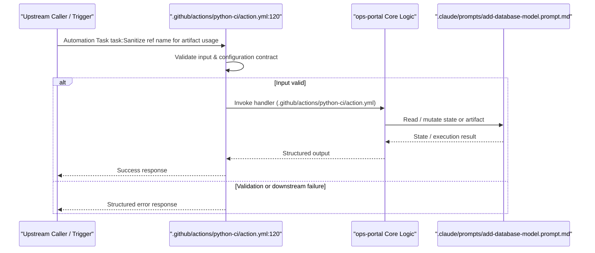

## Flow 12: `task:Upload coverage HTML Report` (`Automation Task`)

<!-- Source: .github/actions/python-ci/action.yml:127 -->
- **Source File:** `.github/actions/python-ci/action.yml:127`
- **Handler / Symbol:** `.github/actions/python-ci/action.yml:127`
- **Kind:** `Automation Task` · **Active:** `Y`
- **Summary:** Automation task `Upload coverage HTML Report` in `.github/actions/python-ci/action.yml:127`

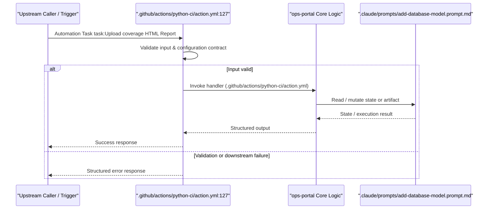

