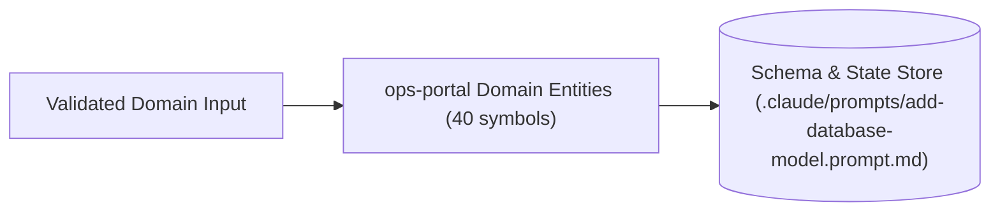

# 07 — Persistence & Data Model: `ops-portal`

## 1. Source-of-Truth & Persistence Overview

- **Primary Data / Schema Location:** `.claude/prompts/add-database-model.prompt.md`
- **Discovered Models / Symbols / Tables:** 40
- **Data & Schema Files Inventoried:** 25

## 2. Data & Schema Artifact Files

- `.claude/prompts/add-database-model.prompt.md` — Data model / schema / state artifact.
- `.github/prompts/add-database-model.prompt.md` — Data model / schema / state artifact.
- `backend/app/api/v1/endpoints/mongodb_atlas.py` — Data model / schema / state artifact.
- `backend/app/core/db_cache.py` — Data model / schema / state artifact.
- `backend/app/models/__init__.py` — Data model / schema / state artifact.
- `backend/app/models/auth.py` — Data model / schema / state artifact.
- `backend/app/models/cost.py` — Data model / schema / state artifact.
- `backend/app/models/database.py` — Data model / schema / state artifact.
- `backend/app/models/notification.py` — Data model / schema / state artifact.
- `backend/app/models/optimization.py` — Data model / schema / state artifact.
- `backend/app/schemas/__init__.py` — Data model / schema / state artifact.
- `backend/app/schemas/auth.py` — Data model / schema / state artifact.
- `backend/app/schemas/checksum_schedules.py` — Data model / schema / state artifact.
- `backend/app/schemas/compliance.py` — Data model / schema / state artifact.
- `backend/app/schemas/cost.py` — Data model / schema / state artifact.
- `backend/app/schemas/credential_inventory.py` — Data model / schema / state artifact.
- `backend/app/schemas/environment.py` — Data model / schema / state artifact.
- `backend/app/schemas/mongodb_atlas.py` — Data model / schema / state artifact.
- `backend/app/schemas/notification.py` — Data model / schema / state artifact.
- `backend/app/schemas/optimization.py` — Data model / schema / state artifact.
- `backend/app/schemas/tools.py` — Data model / schema / state artifact.
- `backend/app/services/keystore_service.py` — Data model / schema / state artifact.
- `backend/app/services/mongodb_atlas_notifications.py` — Data model / schema / state artifact.
- `backend/app/services/mongodb_atlas_scheduler.py` — Data model / schema / state artifact.
- `backend/app/services/mongodb_atlas_service.py` — Data model / schema / state artifact.

## 3. Code-Grounded Entity, Struct, Class & Symbol Catalog

| Symbol / Entity / Schema | Category | Source Location | Signature / Definition |
|---|---|---|---|
| `MySortKey` | Type / Enum | `.claude/agents/UI_Buddy.agent.md:151` | `type MySortKey = "name" \| "status" \| "created_at";` |
| `annotations` | Type / Enum | `.claude/prompts/add-api-endpoint.prompt.md:82` | `- [ ] Pydantic v2 schemas with type annotations` |
| `inheriting` | Class | `.claude/prompts/add-database-model.prompt.md:20` | `2. Define the model class inheriting from 'Base'` |
| `name` | Class | `.claude/prompts/add-database-model.prompt.md:58` | `- 'ModelName': PascalCase class name (e.g., 'ResourceTag')` |
| `implements` | Class | `.claude/prompts/add-new-plugin.prompt.md:36` | `- [ ] Plugin class implements 'PluginBase'` |
| `with` | Class | `.claude/prompts/add-service.prompt.md:22` | `4. Keep state external unless the domain already uses a service class with constructor-inj` |
| `get_all_` | Function | `.claude/prompts/add-service.prompt.md:42` | `async def get_all_{{resource}}(session: AsyncSession) -> list[{{Schema}}Response]:` |
| `create_` | Function | `.claude/prompts/add-service.prompt.md:50` | `async def create_{{resource}}(` |
| `test_` | Function | `.claude/prompts/write-tests.prompt.md:43` | `async def test_{{endpoint_name}}_returns_200():` |
| `ExampleRow` | Type / Enum | `.claude/skills/ui-buddy-page-builder/templates/att-standard-page-template.tsx:5` | `type ExampleRow = {` |
| `ExampleAttStandardPage` | Function | `.claude/skills/ui-buddy-page-builder/templates/att-standard-page-template.tsx:15` | `export default function ExampleAttStandardPage() {` |
| `run_example_page_action` | Function | `.claude/skills/ui-buddy-page-builder/templates/backend-page-mutation-template.py:23` | `async def run_example_page_action(` |
| `PluginBase` | Class | `.copilot/context.md:222` | `class PluginBase:` |
| `register_routes` | Function | `.copilot/context.md:225` | `def register_routes(self, router: APIRouter) -> None: ...` |
| `get_permissions` | Function | `.copilot/context.md:226` | `def get_permissions(self) -> list[str]: ...` |
| `get_dashboard_widgets` | Function | `.copilot/context.md:227` | `def get_dashboard_widgets(self) -> list[DashboardWidget]: ...` |
| `get_daily_costs` | Function | `.copilot/context.md:322` | `\| Python functions \| 'async def get_daily_costs(...)' \|` |
| `check` | Type / Enum | `.github/actions/python-ci/action.yml:2` | `description: "Common Python CI steps: setup, lint, type check, tests with coverage, securi` |
| `checking` | Type / Enum | `.github/actions/python-ci/action.yml:29` | `description: "Whether to run mypy type checking"` |
| `checker` | Type / Enum | `.gitignore:92` | `# Test / type checker / linter caches` |
| `_actor` | Function | `backend/app/api/v1/endpoints/access.py:37` | `async def _actor(request: Request, user: UserContext, db: AsyncSession) -> Actor:` |
| `_notify` | Function | `backend/app/api/v1/endpoints/access.py:44` | `async def _notify(recipients: list[str], subject: str, heading: str, lines: list[str], pat` |
| `_item_label` | Function | `backend/app/api/v1/endpoints/access.py:55` | `def _item_label(item: dict) -> str:` |
| `get_my_access` | Function | `backend/app/api/v1/endpoints/access.py:65` | `async def get_my_access(` |
| `get_catalog` | Function | `backend/app/api/v1/endpoints/access.py:75` | `async def get_catalog(` |

