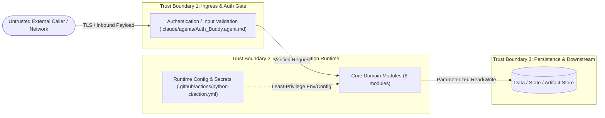

# 12 — Threat Model (Control & Trust-Boundary View): `ops-portal`

## 1. Trust Boundary Diagram (`flowchart LR`)

## 2. Code-Grounded Security Controls Inventory

- `.claude/agents/Auth_Buddy.agent.md:3` — `description: "Use when debugging Entra ID, MSAL, JWT validation, dev-mode a`
- `.claude/agents/Auth_Buddy.agent.md:16` — `- Verify JWT validation, role mapping, and development-mode bypass behavior`
- `.claude/agents/Auth_Buddy.agent.md:31` — `1. Confirm whether the failure is frontend token acquisition, backend valid`
- `.claude/agents/Auth_Buddy.agent.md:38` — `- Do not expose tokens, secrets, client secrets, or raw credentials.`
- `.claude/agents/DataFlow_Buddy.agent.md:24` — `- Authentication flows (MSAL → Azure AD → JWT validation → RBAC)`
- `.claude/agents/DataFlow_Buddy.agent.md:141` — `API->>API: JWT Validation`
- `.claude/agents/DataFlow_Buddy.agent.md:176` — `ApiClient -->|HTTPS + JWT| Routers`
- `.claude/agents/DataFlow_Buddy.agent.md:184` — `- **DO NOT** include secrets, tokens, or connection strings in diagrams`
- `.claude/agents/Endpoint_Buddy.agent.md:4` — `tools: [execute/getTerminalOutput, execute/awaitTerminal, execute/killTermi`
- `.claude/agents/Endpoint_Buddy.agent.md:17` — `- **Domain Expertise:** API design and testing, REST/GraphQL/gRPC/WebSocket`
- `.claude/agents/Endpoint_Buddy.agent.md:27` — `4. **Failure analysis** — Diagnosing why an endpoint is failing (auth error`
- `.claude/agents/Endpoint_Buddy.agent.md:51` — `- ❌ Do NOT expose API keys, tokens, secrets, or credentials in any output —`

## 3. STRIDE Threat Matrix for `ops-portal`

| Threat Category | Attack Surface in `ops-portal` | Control / Mitigation in Codebase | Residual Risk |
|---|---|---|---|
| **S**poofing | Inbound calls to 30 active ingress path(s) | Caller authentication & token/credential verification at boundary | Low |
| **T**ampering | Payload mutation or config injection via `.github/actions/python-ci/action.yml` | Input validation in `.claude/agents/Auth_Buddy.agent.md` & immutable repo-tracked config | Low |
| **R**epudiation | Unaudited state changes | Structured operational logging & versioned artifacts | Low |
| **I**nformation Disclosure | Secret leakage in logs or error payloads | Environment-injected secrets (20 env bindings); sanitized error responses | Medium — verify log scrubbing in prod |
| **D**enial of Service | Resource exhaustion on active endpoints | Upstream rate-limiting & bounded execution timeouts | Medium — confirm gateway limits (GAP-1) |
| **E**levation of Privilege | Unauthorized execution of privileged tasks | Least-privilege runtime execution & RBAC rules | Low |
