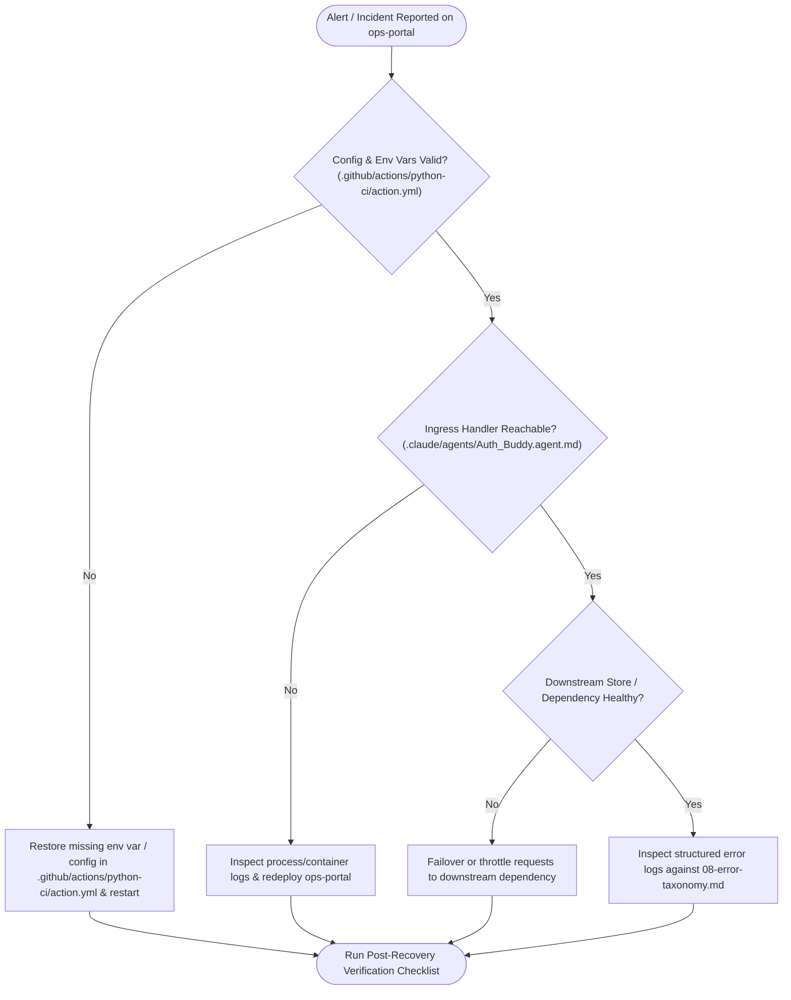

# 14 — Operational Runbook & On-Call Triage Playbook: `ops-portal`

## 1. Incident Triage Flow (`flowchart TD`)

## 2. Pre-Flight & Startup Checklist

- [ ] Confirm `.github/actions/python-ci/action.yml` is present and passes syntax validation.
- [ ] Confirm all 20 environment variable binding(s) documented in `01-README.md` are populated.
- [ ] Confirm build/preparation command succeeds: `npm install && npm run build`.
- [ ] Confirm verification suite passes: `npm test`.
- [ ] Verify primary ingress path (`/action`) responds as expected.

## 3. Symptom -> Diagnostics -> Recovery Playbooks

| Symptom | Diagnostic Step | Recovery Action |
|---|---|---|
| Startup / Initialization Failure | Check logs around `.github/actions/python-ci/action.yml` and environment variable resolution | Supply missing environment variables or restore last known-good `.github/actions/python-ci/action.yml` |
| Ingress Request / Task Rejection | Inspect handler at `.claude/agents/Auth_Buddy.agent.md` and compare input payload against `07-data-model.md` | Correct caller payload or roll back incompatible schema change |
| Elevated Failure Rate | Correlate error logs with `08-error-taxonomy.md` | Roll back recent deployment and verify downstream connectivity |
